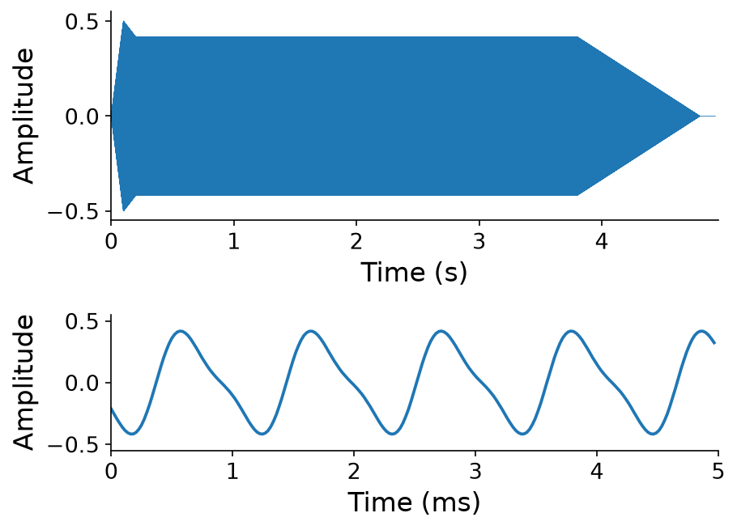
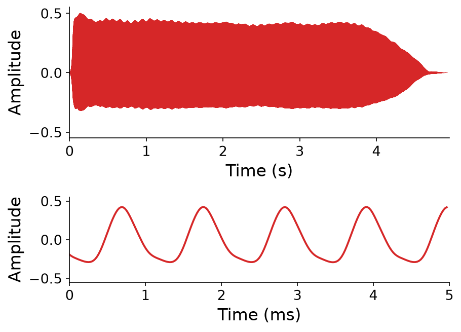

# Sample-based Synthesis

This chapter begins the second part of this book. In the first part (Chapters 1 through 10), we studied the fundamental principles of computer music in depth: how sound becomes digital audio, how to synthesize it, how to analyze it in the frequency domain, and how to process it with filters and frames. Now we shift gears. In the second part, we will survey a _breadth_ of computer music topics that build on these principles. We won't study each topic in as much depth as the fundamentals. Instead, the goal is to expose you to many topics, so that you can find the ones that interest you most and go deeper through self-study.

For our first topic, we will examine {vocab}`sampling` and sample-based synthesis.

:::{admonition} "Sampling" is overloaded
:class: warning
So far in this book, "sampling" has been shorthand for _digital_ sampling, the step of analog-to-digital conversion that measures a signal $f_s$ times per second ({ref}`Chapter 7 <sec-sampling-and-frequency>`). Likewise, a "sample" has referred to a single audio sample $x[n]$.

In this chapter, "sampling" takes on its colloquial meaning: lifting a _clip_ of audio from one source and reusing it in another context, often with some manipulation. Similarly, a "sample" now refers to a clip of audio, not an individual audio sample. When the distinction matters, we will write "audio sample" for $x[n]$.
:::

We will cover two use cases for sampling:

1. **Sampling and sequencing**: extracting samples from recordings and playing them back in new orders and with new timing.
1. **Sample-based synthesis**: manipulating pre-recorded samples on the fly, for example by _repitching_ them, to create instruments that can be played with different expressive parameters.

## Sampling

We first define precisely what we mean by a sample: a contiguous chunk of audio samples extracted from some source recording.

:::{prf:definition} Sample
:label: def-sample
Let $\mathbf{x} = [x[0], x[1], \ldots, x[N-1]]$ be source digital audio at sample rate $f_s$ of length $N$ samples. A _sample_ of $\mathbf{x}$ is a contiguous chunk

$$[~x[m], x[m+1], \ldots, x[m+M-1]~]$$

of length $M \leq N$ audio samples, starting at offset $m \in \{0, 1, \ldots, N - M\}$.
:::

In units of seconds, the sample starts $\frac{m}{f_s}$ seconds into the recording and lasts $\frac{M}{f_s}$ seconds.

We have seen operations like this before. When we extracted {ref}`frames <sec-extracting-frames>` for frame-based processing and {ref}`granular synthesis <sec-granular-synthesis>` in [Chapter 10](../10-frame-proc), each frame was also a contiguous chunk of audio samples.

The key difference here is _how_ we choose $m$ and $M$. In frame-based processing, they are determined procedurally: the offsets are multiples of the hop length $N_H$, and every frame has the same frame length $N_F$. When sampling, by contrast, a person chooses $m$ and $M$ (the start time and duration of the sample) to capture something musically meaningful, like a single drum hit or a memorable phrase. They typically make this choice _by ear_, or visually by looking at the waveform.

:::{margin} The Amen break
The Amen break is a seven-second drum solo, played by Gregory C. Coleman on The Winstons - _Amen, Brother_ (1969). Starting with hip-hop in the late 1980s, producers sampled it relentlessly, and it became the rhythmic backbone of entire genres like jungle and drum and bass. It is often called the most sampled recording in history, appearing in thousands of tracks.
:::

Try it yourself below, using one of the most famous samples of all time: the _Amen break_. Choose an offset $\frac{m}{f_s}$ and a duration $\frac{M}{f_s}$ (both in seconds), and use the zoom to inspect the waveform up close. Can you isolate a single snare drum or cymbal hit?

:::{interactive}[notebooks/sample-explorer.ipynb]
:::

### Extracting samples in Pyquist

In `pyquist`, extracting a sample is a one-liner. We can work in units of _seconds_ with {pyquist}`Audio.segment`, whose `offset` and `duration` arguments correspond to $\frac{m}{f_s}$ and $\frac{M}{f_s}$. Or we can work in units of _audio samples_ by slicing an {pyquist}`Audio` directly with `audio[m:m + M]`, just like a NumPy array.

Below, we extract the second bar of the Amen break both ways. Each beat of the break lasts about $0.435$ seconds, so the second bar starts $4 \times 0.435 = 1.74$ seconds into the recording and lasts just as long:

:::{interactive}[notebooks/extract-samples.ipynb]
:::

Both approaches extract the same $M = 76{,}734$ audio samples. Use whichever units are more natural for the task at hand: seconds when working by ear, and audio samples when you need exact control.

Note that a sample extracted in either fashion does not allocate any new memory. It simply points to those audio samples in their original memory. Accordingly, any manipulations done to the sample will also apply upstream. Use {pyquist}`Audio.copy` to explicitly create a copy of the memory.

## Sequencing

What can we do with samples once we have them? A primary use case is {vocab}`sequencing`: playing samples back in different orders, or with different timing, than in their original recordings. Sequencing is a cornerstone of rhythm production in genres like hip-hop and electronic dance music, where producers build new melodies and beats out of fragments of old ones.

Pyquist's {pyquist}`Score` objects are a natural fit for sequencing. Recall from {ref}`Chapter 4 <def-render>` that rendering a score calls an _instrument_ function once per event, shifts each result to the event's onset time, and sums them all up. There is no requirement that this function synthesize its output audio from scratch. A function that simply returns a sample as an {pyquist}`Audio` object is a perfectly good "instrument". Below, we highlight a couple examples of sequencing using `pyquist` scores.

### Example: Chopping breaks

Our first sequencer rearranges the beats of the Amen break, a practice producers call chopping, which forms the basis of entire genres of music like [jungle](https://en.wikipedia.org/wiki/Jungle_music) and [drum and bass](https://en.wikipedia.org/wiki/Drum_and_bass).

First, let's formally introduce a unit of time that we have glossed over so far. A {vocab}`beat` is a symbolic unit of time in music, referring to the underlying pulse: what you might tap your foot to. The rate of beats, called the {vocab}`tempo`, is usually expressed in ${unit}`beats,minute`$ (BPM). The Amen break is approximately $138.0$ BPM, so each of its beats lasts

$$\frac{1}{138.0} \left[{unit}`minutes,beat`\right] \cdot 60 \left[{unit}`seconds,minute`\right] \approx 0.435 \left[{unit}`seconds,beat`\right].$$

In the code below, we store the tempo as `amen_bpm` and compute `amen_seconds_per_beat` from it. The whole break lasts $16$ beats. We start with an instrument, `amen_sample(offset, duration)`, that extracts a sample of the break with {pyquist}`Audio.segment`, allowing us to control samples with score `Event`s of the form `(2.0, {"offset": 0.0, "duration": 1.0})`. Cutting a sample out of the middle of a recording can leave abrupt edges, which we hear as clicks. So the instrument also applies a very short piecewise-linear envelope, as in [Chapter 4](../04-score-timbre), that fades in over $1$ ms and fades out over $1$ ms.

As a sanity check, a score with one event per beat, each playing that same beat, should reproduce the original break. Then `amen_chop(hits, speed, seed)` builds a new score that plays randomly chosen beats instead, one every $\frac{0.435}{\text{speed}}$ seconds:

:::{interactive}[notebooks/amen-chops.ipynb]
:::

Try other values of `hits`, `speed`, and `seed`.

### Example: ASCII drum machine

Our second sequencer is a {vocab}`drum machine`. Its interface is a grid of _steps_: each row is a drum sound, each column is a moment in time corresponding to a subdivision of a beat, and the musician switches individual cells on or off.

In the Python example below, we crudely mimic a typical drum machine interface with a few lines of text, where an `X` switches a cell on:

```text
X-X-X-X-X-X-X-X-
----X-------X---
X-------X-------
```

Each column of our grid is a quarter of a beat (a [_sixteenth note_](https://en.wikipedia.org/wiki/Sixteenth_note), referring to sixteen of them being present in groupings of $4$ beats). So the function `ascii_to_score` turns the grid into a {pyquist}`Score` with an event at time $\frac{j}{4}$ beats for every `X` in column $j$, whose only parameter is the path to that row's sound file. Our instrument, `drum(path)`, simply loads and returns that sound. Finally, we render the score with a {pyquist}`BasicMetronome`, which converts times in beats to times in seconds at a given tempo. At $120$ BPM, each column lasts $\frac{1}{4} \left[{unit}`beats,column`\right] \cdot \frac{60}{120} \left[{unit}`seconds,beat`\right] = 0.125 \left[{unit}`seconds,column`\right]$:

:::{interactive}[notebooks/drum-machine.ipynb]
:::

Try editing the pattern: move the snare drum, add more kick drums, or change the tempo.

Drum sounds from Freesound: hi-hat [399897](https://freesound.org/s/399897/) by TheFlakesMaster, License: [CC0](http://creativecommons.org/publicdomain/zero/1.0/). Snare drum [46709](https://freesound.org/s/46709/) by boney-man, License: [Attribution 3.0](http://creativecommons.org/licenses/by/3.0/). Kick drum [673512](https://freesound.org/s/673512/) by TheEndOfACycle, License: [CC0](http://creativecommons.org/publicdomain/zero/1.0/).

## Sample-based synthesis

:::{margin} A brief history
Sample-based synthesis predates both digital audio and sampling. Pierre Schaeffer, a pioneer of [_musique concrète_](https://en.wikipedia.org/wiki/Musique_concr%C3%A8te#The_phonog%C3%A8ne), built the _phonogène_, a tape machine whose keyboard changed the playback speed of a tape loop, and with it the pitch. Instruments like the [Mellotron](https://en.wikipedia.org/wiki/Mellotron) later put this idea into mass production. The [Fairlight CMI](https://en.wikipedia.org/wiki/Fairlight_CMI) (1979), the first commercially available digital sampler, was marketed as a way to play realistic sounds, like a piano, that the synthesizers of the day could not produce. Memory was scarce: each voice had just 16 kilobytes for its 8-bit samples, at most about two seconds of audio.
:::

Synthesis techniques like {ref}`frequency modulation <sec-frequency-modulation>` were motivated in part by the goal of producing realistic imitations of musical instruments. This turns out to be extremely difficult! As we saw with the trumpet in [Chapter 6](../06-modulation), the harmonics of real instruments evolve in intricate ways over the course of every note. For example, below we attempt to imitate a clarinet playing A#5 for about five seconds, using the tools of Chapters 3 and 4: a wavetable of two harmonics at the right fundamental frequency, multiplied by an ADSR envelope. The result has the right pitch, duration, and overall shape, but a listener is unlikely to mistake it for the real thing:

:::{audio-figure}
{audio}`Additive synthesis <./assets/audio-clarinet-additive.wav>` 

{audio}`A real clarinet <./assets/clarinet.wav>` 

An imitation of a clarinet with additive synthesis (left), and a recording of a real clarinet (right), each playing A#5 for about five seconds. Each is shown in full (top) and in a 5 ms close-up (bottom). [356904](https://freesound.org/s/356904/) by MTG, License: [Attribution 3.0](http://creativecommons.org/licenses/by/3.0/).
:::

With sampling, we can just "cheat"! Rather than reverse engineering an instrument's sound in order to synthesize it, why not just record the instrument and play it back when needed? This was prohibitively expensive in the early days of computer music, when computers could store only a few seconds of audio in memory. However, these days, it's trivial to store many hours of audio.

But sampling has a key limitation: we are stuck with the _expressive parameters_ that we pre-recorded. Our clarinet recording has one pitch (A#5), one duration (about five seconds), and one loudness. With additive synthesis, we can play any combination of pitch, duration, and loudness simply by changing its parameters. With samples, we can only play back the combinations that we happened to record:

:::{figure}


Additive synthesis (blue) can produce any combination of pitch and duration by changing its parameters. Samples (red) exist only for the combinations that were recorded, e.g. the three cells shown here, and every other combination (?) is unavailable.
:::

:::{margin} Recording everything
An alternative workaround is to simply record the full space of combinations, as commercial sample libraries often aspire to do. These libraries can span hundreds of gigabytes, with recordings of the world's finest instruments played by top studio musicians in world-class recording studios. In practice, however, even these libraries come with features for manipulating expressive parameters on the fly.
:::

We need some way to modify samples _on the fly_, adapting their high-level expressive parameters like pitch, duration, and loudness. This is the idea behind {vocab}`sample-based synthesis`: pre-recording musical material, and applying manipulations on the fly to change its expressive parameters. In the rest of this section, we will develop manipulations for (1) pitch, (2) duration, and (3) loudness.

Compared to the other synthesis techniques we have studied, sample-based synthesis is:

- **Highly realistic**: every note starts from a recording of the real instrument.
- **Computationally cheap**: the manipulations we develop below take only a handful of operations per audio sample.
- **Easy to implement**: as we will see, its core is just a few lines of code.
- **Very general**: it works for any tonal sound, from a clarinet to a sung vowel to a car horn.

But it also has disadvantages:

- **High memory usage**: convincing instruments still require many recordings, often many gigabytes of samples on disk or in memory.
- **Limited range**: the further a manipulation pushes a recording from its original parameters, the less realistic the result sounds.

### Modifying _pitch_ via resampling

Recall {ref}`wavetable synthesis <sec-wavetable-synthesis>` from [Chapter 3](../03-additive-synthesis), where we stored a single cycle of a waveform in a table. We saw that changing the rate at which we read through the table changes the perceived pitch of the output. We can use the same idea to change the pitch of not just a wavetable, but an entire recorded sample stored on disk! Reading through a recording faster raises its pitch, and reading through it slower lowers it.

As a running example for the rest of this chapter, we will use our recording of a clarinet playing A#5. It comes from the Good-sounds dataset, a collection of single notes played by professional musicians on a variety of instruments, recorded by the Music Technology Group (MTG) at Universitat Pompeu Fabra and [available on Freesound](https://freesound.org/people/MTG/packs/20228/). Here is the recording repitched to a range of notes:

:::{audio-board}
{audio}`A#4 <./assets/audio-repitch-As4.wav>`

{audio}`D5 <./assets/audio-repitch-D5.wav>`

{audio}`F5 <./assets/audio-repitch-F5.wav>`

{audio}`A#5 (the original recording) <./assets/audio-repitch-As5.wav>`

{audio}`D6 <./assets/audio-repitch-D6.wav>`


A single recording of A#5 on a clarinet (red), repitched by $k$ steps to play A#4, D5, F5, and D6 (blue). We trimmed the silence from the recording, normalized its level, and fine-tuned its pitch.
:::

If you listen closely, you may notice that the lower notes also last longer, and the higher notes are shorter. We will return to this side effect soon.

Let's make this precise. Recall {ref}`resampling <sec-resampling>` from [Chapter 7](../07-sampling-theory), which maps a vector of $N$ audio samples $\mathbf{x}$ to a new vector of $M$ audio samples $\mathbf{y}$ by reading $\mathbf{x}$ at fractional positions $p$, interpolating between neighboring audio samples. To change the playback speed of a recording from an original duration of $T_1$ seconds to a new duration of $T_2$ seconds, we keep the sample rate fixed, set the new length to $M = N \cdot \frac{T_2}{T_1}$, and read

$$y[m] = \text{Interpolate}\!\left(\mathbf{x},\; p = m \cdot \frac{T_1}{T_2}\right).$$

What does this do to the frequencies in the recording? Suppose the recording contains a component at frequency $f_1$. Playback covers $T_1$ seconds of the recording in $T_2$ seconds, so it advances through the recording at $\frac{T_1}{T_2}$ input seconds per output second. Working through the units, the output contains that component at

$$f_2 \left[{unit}`cycles,output second`\right] = f_1 \left[{unit}`cycles,input second`\right] \cdot \frac{T_1}{T_2} \left[{unit}`input seconds,output second`\right] = f_1 \cdot \frac{T_1}{T_2}.$$

Every frequency in the recording is multiplied by the same factor $\frac{T_1}{T_2}$, the ratio of the original duration to the new one.

This raises a key question: **how should we configure the ratio $\frac{T_1}{T_2}$ to change pitch in units of steps?** Recall from {prf:ref}`def-step` in [Chapter 4](../04-score-timbre) that raising a frequency by $k$ steps multiplies it by $2^{k/12}$. Setting $f_2 = f_1 \cdot 2^{k/12}$, we need

$$\frac{T_1}{T_2} = 2^{k/12}, \qquad \text{or equivalently} \qquad T_2 = \frac{T_1}{2^{k/12}}.$$

For example, to shift a recording of C4 up to G4 ($k = 7$ steps), we read it $2^{7/12} \approx 1.498$ times faster than normal. If the C4 recording lasts $2$ seconds, the resulting G4 lasts $\frac{2}{1.498} \approx 1.33$ seconds. To shift a recording _down_, $k$ is negative, so the ratio is less than $1$ and we read the recording slower.

The widget below repitches our clarinet by any number of steps. Watch the duration of the note and the spacing of its cycles change together.

:::{interactive}[notebooks/repitch-coupling.ipynb]
:::

The code below implements repitching. The function `resample(x, ratio)` reads `x` at `ratio` times its original speed with linear interpolation, keeping the output sample rate the same. It is just like the wavetable reader of Chapter 3, minus the wraparound. Then, `repitch(x, k)` shifts the pitch of `x` by $k$ steps by resampling it with a ratio of $2^{k/12}$. Finally, `clarinet(pitch)` is an instrument that plays any pitch by repitching our single recording of A#5:

:::{interactive}[notebooks/repitch.ipynb]
:::

:::{margin}
Recall from [Chapter 7](../07-sampling-theory) that reading a recording faster can also push its highest harmonics past the Nyquist frequency, where they alias. High-quality samplers avoid this by low-pass filtering the recording before reading it faster, much like Pyquist's bandlimited {pyquist}`Audio.resample`.
:::

In theory, a single recording can now be shifted to any pitch. In practice, the larger $|k|$ is, the less realistic the result sounds. So sample-based instruments typically pre-record several pitches across the range of the instrument, and resample whichever recording is closest to the target pitch, a practice called {vocab}`multisampling`.

Resampling gives us control over pitch. However, there's a catch: **duration and pitch are now _coupled_**! Repitching our A#5 recording down an octave doubles its duration, and repitching it up an octave halves it. When we play music, we want to control the duration of each note independently of its pitch, just like for the other synthesis methods we have studied.

### Modifying _duration_ via looping

Recall from {ref}`Chapter 4 <sec-envelope-phases>` that the notes of real instruments pass through multiple phases: an attack, a decay, a sustain, and a release. Suppose we have a single recording of a note, repitched or otherwise, that lasts some fixed duration. How can we adjust its duration?

The key insight comes from how these phases behave as duration changes. When the same instrument plays notes of two different durations, the attack, decay, and release are roughly the same in both. Only the sustain is elongated (or shortened), and this elongation is quasi-periodic at the note's fundamental period. This suggests a strategy: keep the attack and release of the recording as they are, identify a portion of the recorded sustain, and _loop_ it, repeating it as many times as needed to reach the desired duration:

:::{figure}


Our clarinet note (top), shaded by phase, with a sustain loop (orange) in the steady part of its sustain. To play a note of any duration (bottom), everything before the loop plays once, the loop repeats as many times as needed, and playback then jumps to a point shortly before the release, skipping the rest of the recorded sustain.
:::

Let's formalize this. We choose a {vocab}`sustain loop` spanning the time range $[t_s, t_e)$ of the recording, and let $T_R$ be the duration of the end of the recording that we jump to, which contains the release. To play a note lasting $T$ seconds, we play the first $t_s$ seconds of the recording, then the loop as many times as needed, then the end of the recording. So the loop repeats

$$n = \frac{T - (t_s + T_R)}{t_e - t_s}$$

times, which we round to the nearest whole number.

For example, suppose a recording has a loop from $t_s = 0.5$ to $t_e = 0.75$ seconds, and the end of the recording that we jump to lasts $T_R = 1$ second. Then a note lasting $T = 4$ seconds needs $n = \frac{4 - (0.5 + 1)}{0.25} = 10$ repetitions of the loop.

Where exactly should the loop begin and end? For the loop to repeat seamlessly, the waveform at its end should flow smoothly back into the waveform at its start. Within the sustain, the waveform is quasi-periodic, so ideally the loop spans a whole number of periods of the fundamental. The catch is that the loop must be a whole number of audio samples long, but **a period is rarely a whole number of audio samples**.

For example, our clarinet's A#5 has a fundamental frequency of $f_0 \approx 932.33$ Hz, so one period lasts $\frac{f_s}{f_0} = \frac{44{,}100}{932.33} \approx 47.30$ audio samples. A loop of either $47$ or $48$ audio samples would not line up with the waveform, so every wrap would jump by a fraction of a period, more than $900$ times per second.

There are two common workarounds. The first is to loop over many periods instead of one, choosing the loop points by inspecting the waveform for a start and an end whose surroundings match closely.

We chose the loop points for our clarinet this way, along with the point where it jumps to the release. Putting it all together with repitching, here is our clarinet with independent control over pitch and duration. Notice the order of operations: we loop first, at the recording's original pitch, so that the loop points are exact audio samples. Only then do we repitch, because resampling a loop can make its seams worse. Since repitching scales the duration by $2^{-k/12}$, we loop to a duration of $T \cdot 2^{k/12}$ seconds before repitching:

:::{interactive}[notebooks/loop.ipynb]
:::

The second workaround addresses a subtler problem. Real sounds are only quasi-periodic, so the end of a loop never matches its start exactly. To smooth over the remaining mismatch, samplers often {vocab}`crossfade` at each wrap: they gradually fade out the end of the loop while fading in the audio that originally led into the loop's start:

:::{figure}
![A schematic with two rows. The top row, labeled recording, shows a timeline with a loop region between marks t_s and t_e. A gold block labeled pre-start sits just before t_s, and a red block labeled tail occupies the end of the loop just before t_e. The bottom row, labeled one pass of the loop, shows the loop region with its final block crossed by a falling red line and a rising gold line, annotated crossfade: tail out, pre-start in. A gold arrow leads from the pre-start block to the crossfade, and a gray arrow below loops from the end of the pass back to its start, labeled then wrap back to t_s and continue.](./assets/fig-loop-crossfade.png)

Crossfading a loop. Just before each wrap, the end of the loop (red) fades out while the audio just before $t_s$ (gold) fades in. Each pass therefore ends on the audio that originally led into $t_s$, so wrapping back to $t_s$ is seamless.
:::

The widget below lets us place a sustain loop ourselves. Try a loop of exactly one period, then a loop of many periods, then add a crossfade, and listen to how each one changes the seams.

:::{interactive}[notebooks/sustain-loop.ipynb]
:::

### Modifying _loudness_

Finally, we want to control the loudness of each note with a parameter $\ell \in [0, 1]$, from silent ($\ell = 0$) to the full level of the recording ($\ell = 1$). Recall from [Chapter 7](../07-sampling-theory) that we perceive loudness on a logarithmic scale, which is why we measure it in {ref}`decibels <def-decibel>`. So a simple approach maps $\ell \in (0, 1]$ linearly onto a range of decibels, from $-80$ dB (nearly inaudible) up to $0$ dB (the level of the recording), and maps $\ell = 0$ to $-\infty$ dB (silence):

$$\text{dB}(\ell) = \begin{cases} 80 \cdot (\ell - 1) & \text{if } 0 < \ell \leq 1, \\ -\infty & \text{if } \ell = 0. \end{cases}$$

We then multiply the note by the corresponding amplitude, $10^{\text{dB}(\ell) / 20}$. Here is the final version of our sampled clarinet, with independent control over pitch, duration, and loudness:

:::{interactive}[notebooks/loudness.ipynb]
:::

Real instruments also sound _brighter_ when played louder, because playing harder strengthens their upper harmonics. To explore further, try low-pass filtering each note with a cutoff frequency that rises with $\ell$, using the filters from [Chapter 9](../09-filters). The complete instrument is also in [code/sampler.py](./code/sampler.py).

## Summary

- In this chapter, "sampling" means lifting a clip of audio, a _sample_, from one recording and reusing it in another context. A sample is a contiguous chunk $[x[m], \ldots, x[m + M - 1]]$ of a recording, whose offset $m \in \{0, \ldots, N - M\}$ and length $M$ are usually chosen by ear rather than procedurally.
- {vocab}`Sequencing` plays samples back in new orders and with new timing. In Pyquist, a sequence of samples is just a {pyquist}`Score` whose instrument returns samples, from a chopped breakbeat to the grid of a {vocab}`drum machine`. Musical time is counted in beats, at a tempo measured in beats per minute (BPM).
- {vocab}`Sample-based synthesis` pre-records musical material and manipulates it on the fly to change its expressive parameters, filling in the combinations of pitch, duration, and loudness that were never recorded. It is realistic, cheap to compute, and easy to implement, but it uses a lot of memory.
- **Pitch**: resampling a recording by the ratio $\frac{T_1}{T_2} = 2^{k/12}$ shifts its pitch by $k$ steps, but also scales its duration by $2^{-k/12}$. {vocab}`Multisampling` keeps $|k|$ small, for realism.
- **Duration**: a {vocab}`sustain loop` replaces the recorded sustain with as many repetitions as a note needs, keeping the attack and release. A period is rarely a whole number of audio samples, so good loops span many periods, and a {vocab}`crossfade` smooths over each wrap.
- **Loudness**: mapping a loudness $\ell \in (0, 1]$ linearly onto $-80$ to $0$ dB, and $\ell = 0$ to silence, gives a simple volume control that matches our logarithmic perception of loudness.

## Questions for the reader

::::{exercise}
**Extracting a sample.** A recording at $f_s = 48{,}000$ Hz lasts exactly $3$ seconds.

1. How many audio samples $N$ does it contain?
1. You want a sample that starts $1.2$ seconds into the recording and lasts $250$ ms. What are its offset $m$ and length $M$?
1. For this length $M$, what is the largest valid offset $m$? How many seconds into the recording does that sample start?

:::{solution}

1. $N = 144{,}000$
1. $m = 57{,}600$ and $M = 12{,}000$
1. $m = 132{,}000$, which starts $2.75$ seconds into the recording

:::
::::

::::{exercise}
**Beats and steps.** A drum pattern is written on a grid in which each column is a sixteenth note, a quarter of a beat. The pattern plays at a tempo of $90$ BPM.

1. How long does each column last, in milliseconds?
1. Counting columns from $0$, at what time does a hit in column $12$ play? Give your answer in beats and in seconds.

:::{solution}

1. $\approx 166.7$ ms
1. $3$ beats, or $2$ seconds

:::
::::

::::{exercise}
**Repitching.** You have a $2$-second recording of A4 ($440$ Hz), and you want to shift it up $3$ steps to C5.

1. By what factor $\frac{T_1}{T_2}$ must you speed up its playback?
1. What is the fundamental frequency of the result?
1. How long does the result last?

:::{solution}

1. $2^{3/12} \approx 1.189$
1. $\approx 523.3$ Hz
1. $\approx 1.68$ seconds

:::
::::

::::{exercise}
**Multisampling.** A sampled piano records each of its $88$ keys at $4$ different loudness levels. Each recording lasts $10$ seconds, in stereo, at $f_s = 48{,}000$ Hz, with $24$-bit ($3$-byte) audio samples.

1. How much storage does the library need, in gigabytes?
1. To save space, you instead record every third key (keys $1, 4, 7, \ldots, 88$), and you play each of the other keys by repitching the closest recording. How many keys do you record, how much storage does the library need now, and what is the largest pitch shift $|k|$, in steps, that you will ever need?

:::{solution}

1. $\approx 1.01$ GB
1. $30$ keys, $\approx 0.35$ GB, and $|k| \leq 1$

:::
::::

::::{exercise}
**Counting loops.** A recording of a note has a sustain loop spanning $t_s = 0.15$ to $t_e = 0.40$ seconds, and its release lasts $T_R = 0.25$ seconds. How many times must the loop repeat to play a note lasting $T = 2.4$ seconds?

:::{solution}
$8$ times
:::
::::

::::{exercise}
**Choosing loop points.** A sustained note with a fundamental frequency of $f_0 = 440$ Hz is recorded at $f_s = 44{,}100$ Hz.

1. How many audio samples long is one cycle of the fundamental?
1. What is the shortest loop that spans both a whole number of cycles _and_ a whole number of audio samples? Give its length in cycles, in audio samples, and in milliseconds.

:::{solution}

1. $\approx 100.23$ audio samples
1. $22$ cycles, which is exactly $2{,}205$ audio samples, or $50$ ms

:::
::::

::::{exercise}
**Loudness.** Using this chapter's mapping from a loudness $\ell \in (0, 1]$ to decibels:

1. What gain, in decibels and as an amplitude factor, does a note played at $\ell = 0.75$ receive?
1. Approximately what loudness $\ell$ halves the amplitude of a note?

:::{solution}

1. $-20$ dB, an amplitude factor of $0.1$
1. $\ell \approx 0.925$

:::
::::

## Musical examples

### Pierre Schaeffer and Pierre Henry - _Symphonie pour un homme seul_ (1950)

A landmark of _musique concrète_, the movement that first made music by collaging recorded sounds. Schaeffer and Henry built this "symphony for one man alone" from recordings of the human body (breathing, footsteps, voices, and whistling) alongside fragments of instrumental sounds. In this era, sampling and sequencing meant physically manipulating recordings on magnetic tape, decades before digital samplers existed.

<iframe width="560" height="315" src="https://www.youtube-nocookie.com/embed/MOYNFu45khQ" title="YouTube video player" frameborder="0" allow="accelerometer; autoplay; clipboard-write; encrypted-media; gyroscope; picture-in-picture; web-share" referrerpolicy="strict-origin-when-cross-origin" allowfullscreen></iframe>

### Tracklib - _The Most Iconic Hip-Hop Sample of Every Year_ (1973–2023)

Hip-hop artists pioneered the modern practice of sampling and sequencing, beginning with DJs who extended the drum breaks of funk and soul records by looping them on two turntables. This video surveys fifty years of the genre through one iconic sample per year, showing how producers have chopped, looped, and re-sequenced fragments of older recordings into new music.

<iframe width="560" height="315" src="https://www.youtube-nocookie.com/embed/hIGNaDk9eIA" title="YouTube video player" frameborder="0" allow="accelerometer; autoplay; clipboard-write; encrypted-media; gyroscope; picture-in-picture; web-share" referrerpolicy="strict-origin-when-cross-origin" allowfullscreen></iframe>

### The Avalanches - _Frontier Psychiatrist_ (2000)

The Avalanches' debut album, _Since I Left You_, is built almost entirely from samples. The track _Frontier Psychiatrist_ sequences dialogue from a comedy sketch of the same name over an orchestral backing sampled from an Enoch Light record, among [dozens of other sampled fragments](https://www.whosampled.com/The-Avalanches/Frontier-Psychiatrist/samples).

<iframe width="560" height="315" src="https://www.youtube-nocookie.com/embed/qLrnkK2YEcE" title="YouTube video player" frameborder="0" allow="accelerometer; autoplay; clipboard-write; encrypted-media; gyroscope; picture-in-picture; web-share" referrerpolicy="strict-origin-when-cross-origin" allowfullscreen></iframe>

### Herbie Hancock and Quincy Jones - _Fairlight CMI_ (1984)

Watch Herbie Hancock and Quincy Jones experiment with the Fairlight CMI, the earliest commercially available digital sampler. Each key of its keyboard plays back a recorded sample, repitched by changing its playback speed, which is exactly the technique of this chapter.

<iframe width="560" height="315" src="https://www.youtube-nocookie.com/embed/n6QsusDS_8A" title="YouTube video player" frameborder="0" allow="accelerometer; autoplay; clipboard-write; encrypted-media; gyroscope; picture-in-picture; web-share" referrerpolicy="strict-origin-when-cross-origin" allowfullscreen></iframe>

### clipping. - _Williams Mix_ (2014)

The experimental hip-hop group clipping. closes its album _CLPPNG_ with a version of [John Cage's _Williams Mix_](https://en.wikipedia.org/wiki/Williams_Mix) (1952), a pioneering tape piece built from hundreds of fragments of recorded sound, spliced together according to a score that Cage composed with chance operations. Computer musician Tom Erbe, who recreated Cage's piece in software from its original score, realized this version using fragments of the album's own tracks as source material. The result is sampling and sequencing, with the sequence dictated by Cage's score.

<iframe width="560" height="315" src="https://www.youtube-nocookie.com/embed/_YmTrYYUVzc" title="YouTube video player" frameborder="0" allow="accelerometer; autoplay; clipboard-write; encrypted-media; gyroscope; picture-in-picture; web-share" referrerpolicy="strict-origin-when-cross-origin" allowfullscreen></iframe>
