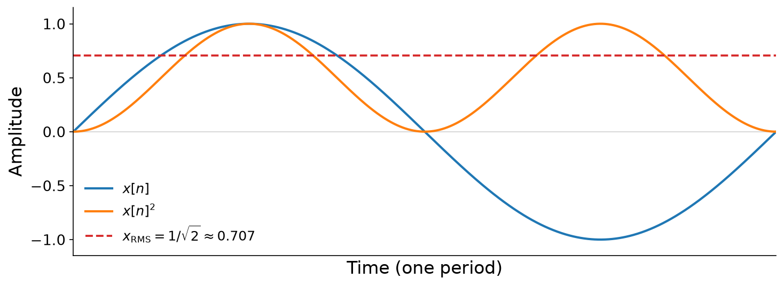

# Effects and Spatial Audio

In this chapter, we study audio {vocab}`effects`: processes that transform a sound, usually for creative purposes in sound design and music production. Formally, effects are filters, in the broad sense of [Chapter 9](../09-filters): functions that map input audio $\mathbf{x} \in \mathbb{R}^N$ to output audio $\mathbf{y} \in \mathbb{R}^N$. But when we say "effect", we usually mean a filter that is either (1) _not_ LTI, or (2) LTI, but built from simpler filters arranged in more sophisticated topologies.

Effects are built from different signal processing techniques, some of which we've already studied, and some of which we have not. In each section of this chapter, we will examine one of these techniques from a technical perspective, and also explore the family of creative effects it gives rise to.

In the last section of this chapter, we study {vocab}`spatial audio`: combining multichannel digital audio with playback over multiple loudspeakers, to preserve the cues that we use to locate sound sources in space.

## Preliminary: Wet/dry mix

Audio that has been processed by an effect is called {vocab}`wet`, and the unprocessed audio is called {vocab}`dry`. A technique common to nearly every effect is to blend the two:

:::{prf:definition} Wet/dry mix
:label: def-wet-dry-mix
Given dry audio $\mathbf{x}$ and wet audio $\mathbf{y}$, the _wet/dry mix_ with wet ratio $w \in [0, 1]$ is

$$(1 - w) \cdot \mathbf{x} + w \cdot \mathbf{y}.$$
:::

A wet ratio of $w = 0$ outputs the dry signal $\mathbf{x}$, $w = 1$ outputs the wet signal $\mathbf{y}$, and $0 < w < 1$ blends the two. Since we perceive loudness on a logarithmic scale, the mix is often expressed instead as a _wet-to-dry ratio_ in {prf:ref}`decibels <def-decibel>`, comparing the weight of the wet signal to the weight of the dry signal:

$$\text{dB} = 20 \log_{10}\left(\frac{w}{1 - w}\right).$$

Solving for $w$, we have $\frac{w}{1 - w} = 10^{\text{dB}/20}$, so

$$w = \frac{10^{\text{dB}/20}}{1 + 10^{\text{dB}/20}} = \frac{1}{1 + 10^{-\text{dB}/20}}.$$

For example, a wet-to-dry ratio of $0$ dB gives $w = \frac{1}{2}$: equal parts wet and dry. A ratio of $6$ dB gives $w \approx \frac{2}{3}$, weighting the wet signal about twice as heavily as the dry. The code examples in this chapter compute $w$ with a small helper function, which uses {pyquist}`db_to_amplitude` to compute $10^{-\text{dB}/20}$:

```python
def wet_ratio(db: float) -> float:
    """The wet ratio w that mixes the wet signal `db` decibels above the dry signal."""
    return 1 / (1 + pq.helper.db_to_amplitude(-db))
```

## Feedback delay

We begin with a family of effects built from a single primitive that we met in [Chapter 12](../12-physical-models): the feedback delay line,

$$y[n] = x[n] + g \cdot y[n - M].$$

Recall that its impulse response is an impulse train that decays by a factor of $g$ every $M$ samples:

$$h[n] = \begin{cases} g^{n / M} & \text{if } n = k \cdot M \text{ for some } k \in \mathbb{Z}_{\geq 0}, \\ 0 & \text{otherwise.} \end{cases}$$

And as we saw in Chapter 12, its frequency response is a comb, with teeth at whole-number multiples of $\frac{f_s}{M}$. The delay $M$ sets the spacing of the echoes in time, and of the teeth in frequency, while the gain $g$ sets how quickly the echoes decay, and how sharp the teeth are:

:::{figure}
![A four-by-four grid. Rows vary the gain g from 0.25 to 0.95, and columns vary the delay M from 50 to 11025 samples, labeled with their durations, from 1.1 ms to 250 ms, and their tooth spacings f_s over M, from 882 Hz down to 4 Hz. Each cell shows an impulse response on top, red stems spaced M samples apart whose heights decay by g each time, and a magnitude response on the bottom, from 0 to 1000 Hz. Larger g makes the stems decay more slowly and the peaks of the magnitude response taller and sharper. Larger M spaces the stems further apart in time and packs the peaks more densely in frequency, until at 250 ms they blur together.](./assets/fig-feedback-grid.png)

Impulse responses (top of each cell) and magnitude responses (bottom of each cell) of feedback delay lines with four gains $g$ (rows) and four delays $M$ (columns), at $f_s = 44{,}100$ Hz.
:::

Here is the same `feedback_delay` function from Chapter 12, which we will use in the examples that follow:

:::{interactive}[notebooks/feedback-delay.ipynb]
:::

In Chapter 12, we used a feedback delay line to model the acoustics of a string, by feeding it unit impulses and bursts of noise. But what happens if the input $\mathbf{x}$ is some other sound? And how does our perception of the result change as we vary $M$? The answer hinges on the comb's tooth spacing, $\frac{f_s}{M}$ and how it compares to the lower limit of human hearing ($20$ Hz).

### Comb filtering

When $M$ is small, the teeth of the comb are spaced far apart, at whole-number multiples of $f_0 = \frac{f_s}{M}$. As $M$ shrinks, $f_0$ grows, and once it exceeds $20$ Hz, we perceive it as the fundamental frequency of a tone. So a feedback delay line with a small $M$ imposes a pitch on any sound passed through it, an effect known as _comb filtering_. The gain $g$ determines the strength of the effect: the closer $g$ is to $1$, the sharper the teeth, and the more clearly we hear the pitch.

The code below passes a recording of a bouncing ball through a feedback delay line with $M = 200$ samples. Every bounce now rings at a pitch of $f_0 = \frac{44{,}100}{200} = 220.5$ Hz:

:::{interactive}[notebooks/comb-filtering.ipynb]
:::

Sound from Freesound: [445724](https://freesound.org/s/445724/) by 180241virtualwindow.co.za, License: [Attribution NonCommercial 3.0](http://creativecommons.org/licenses/by-nc/3.0/).

### Delay

When $M$ grows so large that $\frac{f_s}{M} \leq 20$ Hz, the teeth of the comb crowd so close together that we stop perceiving them as harmonics. Instead, we perceive the delayed copies as distinct sound events, or echoes. By the units, this happens once the delay lasts

$$\frac{M}{f_s} \left[{unit}`samples,trip` \cdot {unit}`seconds,sample`\right] \geq \frac{1}{20} \left[{unit}`seconds,trip`\right],$$

or $50$ ms. This regime is what guitarists colloquially call a _delay_ effect.

Delays are often timed to the music. The code below adds a delay to a guitar that plays a note every $0.221$ seconds. We set the delay to half of that, so every echo lands halfway between two notes, and the guitar sounds like it is playing twice as fast:

:::{interactive}[notebooks/delay.ipynb]
:::

Sound from Freesound: [453384](https://freesound.org/s/453384/) by loudernoises, License: [CC0](http://creativecommons.org/publicdomain/zero/1.0/).

### Echo

Suppose we make $M$ very long, on the order of seconds. We still perceive the delayed copies as distinct sound events, but they arrive so long after the original that they no longer sound like a part of it. Instead, they sound like a reflection from a distant surface, like shouting into a canyon. For example, sound travels at about $343$ m/s, so an echo that returns after $1$ second has traveled $343$ meters, to a cliff about $171.5$ meters away and back.

The code below sets $M = f_s$, a $1$ second delay, and applies it to a short yodel:

:::{interactive}[notebooks/echo.ipynb]
:::

Sound from Freesound: [484841](https://freesound.org/s/484841/) by Astounded, License: [CC0](http://creativecommons.org/publicdomain/zero/1.0/).

## Tapped delay lines

So far, the delay $M$ has been fixed. But we can also make the delay a function of time, $M[n] > 0$:

$$y[n] = x[n] + g \cdot y[n - M[n]].$$

This requires a new mechanism, a {vocab}`tapped delay line`. Before, a delay of $M$ samples required a delay line of length $M$, which we read at its far end. Now, we need a delay line long enough for the longest delay, $M' = \max_n M[n]$, and we read it at a time-varying position in the middle, called a _tap_:

:::{figure}
![Two signal-flow diagrams. Top, labeled fixed delay: x[n] enters a single long block labeled z to the minus M, which outputs x[n minus M]. Bottom, labeled variable delay: x[n] enters a block labeled z to the minus M[n], followed by a block labeled z to the minus (M prime minus M[n]), which outputs x[n minus M prime]. Between the two blocks, a tap point leads down to the label tap: x[n minus M[n]].](./assets/fig-tapped-delay.png)

A fixed delay line (top), and a delay line of length $M'$ with a time-varying tap (bottom). The tap reads the delay line $M[n]$ samples back from its input.
:::

The delay line is still a circular buffer, and only the read position of the tap changes.

In addition to changing the amount of delay in a time-varying fashion, it would also be convenient to be able for thoes delay amounts to be _fractional_, rather than an integer number of samples.
To achieve this, we can simply linearly interpolate between neighboring samples in our dealy line, just like the wavetables of [Chapter 3](../03-additive-synthesis).

The code below extends our feedback delay line to time-varying, fractional delays. To hear it in action, we sweep the delay of a comb filter from $\frac{f_s}{110}$ samples down to $\frac{f_s}{440}$ samples, while feeding it white noise. The pitch of the comb glides up two octaves:

:::{interactive}[notebooks/variable-delay.ipynb]
:::

### Flanging

Variable delays enable a classic effect called {vocab}`flanging`. It originated with analog tape machines: engineers played the same recording on two tape machines at once, and slowed one down slightly by pressing a finger against the rim, or _flange_, of its tape reel. The small, varying delay between the two copies creates a comb filter whose teeth sweep up and down in frequency, which sounds like a whooshing jet plane.

:::{figure} ./assets/fig-tape-flanger.png
:width: 45%
:alt: Two tape machines, each with two reels. The outputs of the two machines meet at a summing junction, whose output is y(n). One reel of the right machine is labeled flange, pointing at the rim of the reel.

Tape flanging: the same recording plays on two tape machines, whose outputs are summed. Pressing on the flange of a reel slows one machine down slightly, which delays its copy. Figure from Tamara Smyth's [course notes](https://musicweb.ucsd.edu/~trsmyth/filtersDelayII/Flanger.html).
:::

To simulate a flanger, we sweep the delay of a feedback delay line up and down with a slow sinusoid: around a center delay of $M_c$ samples, by a relative depth $A$ (between $0$ and $1$), at a rate of $f_m$ Hz:

$$M[n] = M_c \cdot \left(1 + A \sin\left(2\pi f_m \frac{n}{f_s}\right)\right).$$

Flangers typically use delays of just a few milliseconds. As the delay sweeps, so does the comb: its lowest tooth, at $\frac{f_s}{M[n]}$, sweeps between a few hundred and a few thousand Hz. But while the delay sweeps sinusoidally, the comb does not. Its frequency is the reciprocal of the delay, so it lingers at low frequencies, and darts up to high frequencies whenever the delay is shortest:

:::{figure}


The delay of a flanger with $M_c = 3$ ms, $A = 0.9$, and $f_m = 0.25$ Hz (top), which sweeps between $0.3$ and $5.7$ ms every $4$ seconds, and the corresponding frequency of the lowest tooth of its comb, $\frac{f_s}{M[n]}$ (bottom), which sweeps between about $175$ and $3333$ Hz.
:::

The code below applies this flanger to a synthesizer pad and to a distorted guitar:

:::{interactive}[notebooks/flanging.ipynb]
:::

Sounds from Freesound: pad [37746](https://freesound.org/s/37746/) by Quilt, License: [CC0](http://creativecommons.org/publicdomain/zero/1.0/). Guitar [235538](https://freesound.org/s/235538/) by simosco, License: [CC0](http://creativecommons.org/publicdomain/zero/1.0/).

## Multitap delay lines

A tapped delay line need not stop at one tap. A {vocab}`multitap delay line` reads one delay line at several positions. For example, with taps at $M_a < M_b < M'$:

:::{figure}
![A signal-flow diagram. x[n] passes through three blocks in series, labeled z to the minus M_a, z to the minus (M_b minus M_a), and z to the minus (M prime minus M_b), and exits as x[n minus M prime]. Taps between the blocks lead down to the labels x[n minus M_a] and x[n minus M_b].](./assets/fig-multitap.png)

A delay line of length $M'$ with taps at $M_a$ and $M_b$. The delays of the blocks between taps add up to $M'$.
:::

The code below implements a multitap delay line, whose taps may vary over time and take fractional values. It returns one row of output per tap, like one channel of multichannel audio per tap:

:::{interactive}[notebooks/multitap.ipynb]
:::

### Chorus

When several people sing the same melody together, their voices never line up perfectly. Each singer's timing, pitch, and loudness deviate slightly from the others, and these small deviations give a choir its rich, full sound. The {vocab}`chorus` effect simulates this, by mixing a sound with several copies of itself, each delayed by a slowly varying amount:

:::{figure}
![A signal-flow diagram. The input x[n] splits into a dry path along the top, and three branches. Each branch passes through a delay block, labeled z to the minus M_1[n], M_2[n], and M_3[n], and then a triangular gain, labeled g_1, g_2, and g_3. The dry path and all three branches meet at a summing junction, whose output is y[n].](./assets/fig-chorus.png)

A chorus with three voices. Each voice is a copy of the input with its own time-varying delay $M_k[n]$ and gain $g_k$.
:::

A chorus is like a flanger with several delayed copies. But a chorus uses longer delays, typically $20$ to $30$ ms, and no feedback. A delay that changes over time also shifts the pitch of its copy slightly, because the tap moves through the delay line slightly faster or slower than the samples arrive, much like the resampling of [Chapter 11](../11-sampled-synthesis). So each voice of a chorus wavers slightly in pitch, like a real singer. The code below builds a three-voice chorus from our multitap delay line, and applies it to a guitar arpeggio:

:::{interactive}[notebooks/chorus.ipynb]
:::

Sound from Freesound: [453384](https://freesound.org/s/453384/) by loudernoises, License: [CC0](http://creativecommons.org/publicdomain/zero/1.0/).

## All-pass filters

When a sound is played in a room, it bounces off the walls, the floor, and everything in between. Each reflection arrives at a slightly different time, from a slightly different direction, and with a different attenuation. The result is {vocab}`reverberation`: thousands of overlapping, delayed copies of the sound. We can see them in the impulse response of a real room, like the church whose impulse response we used for convolution reverb in Chapter 9:

:::{figure}


The impulse response of a church, in full (left) and over its first $100$ ms (right). After the direct sound, the first reflections arrive as distinct spikes, which soon blur together into thousands of overlapping echoes that decay over about $2$ seconds. Impulse response from Freesound: [IR_Church_01](https://freesound.org/s/474296/) by snapssound, License: [Attribution 4.0](https://creativecommons.org/licenses/by/4.0/).
:::

Could we simulate reverberation with feedback delay lines? There are two issues. First, a feedback delay line is a comb filter, which _colors_ the sound by imposing the pitch of its teeth, rather than sounding like a room. Second, a realistic reverb needs a huge number of echoes, and so a huge number of delay lines. We could instead use the convolution reverb of Chapter 9, but it requires recording the impulse response of a real room, so it is limited to rooms we have access to.

The solution is a different building block. Recall from Chapter 9 that an {vocab}`all-pass` filter leaves the amplitude of every frequency untouched, and alters only its phase. Here is a simple all-pass filter built around a delay line:

:::{prf:definition} All-pass filter
:label: def-allpass-filter
The _all-pass filter_ with a delay of $M \in \mathbb{Z}_{>0}$ samples and a gain $|g| < 1$ is the recursive filter

$$y[n] = -g \cdot x[n] + x[n - M] + g \cdot y[n - M].$$

Its magnitude response is $|H(f)| = 1$ at every frequency $f$, while its phase response $\angle H(f)$ varies with frequency.
:::

Compared to a feedback delay line, an all-pass filter adds an inverted feedforward term, $-g \cdot x[n]$, which exactly cancels out the peaks and valleys of the comb:

:::{figure}
![Two plots over frequency from 0 to 22 kHz. Left: magnitude in decibels. A red curve for a feedback comb filter rises to sharp peaks, about 10 dB tall, at regular intervals, with valleys between them. A purple curve for an all-pass filter with the same delay and gain is perfectly flat at 0 dB. Right: phase in radians. The red phase of the comb filter wiggles up and down within about one radian of zero, while the purple phase of the all-pass filter decreases steadily from 0 down to about minus 63 radians at 22 kHz, in a series of steps.](./assets/fig-allpass.png)

The magnitude responses (left) and phase responses (right) of a feedback comb filter and an all-pass filter, both with $M = 20$ and $g = 0.7$.
:::

So an all-pass filter does not color the spectrum of a sound. But its impulse response is still a train of echoes, $h = [-g, 0, \ldots, 0, 1 - g^2, 0, \ldots, 0, g(1 - g^2), \ldots]$, spaced $M$ samples apart. And when we chain all-pass filters in series, their echoes multiply: each echo of the first filter is echoed again by the second. A short chain of all-pass filters can therefore produce dense echoes without coloring the sound.

We can build an all-pass filter from our feedback delay line. If $v[n] = x[n] + g \cdot v[n - M]$ is the output of a feedback delay line, then $y[n] = -g \cdot v[n] + v[n - M]$ is the output of an all-pass filter.

:::{interactive}[notebooks/allpass.ipynb]
:::

### Reverb

In 1962, Manfred Schroeder combined feedback delay lines and all-pass filters into one of the first artificial reverberators {cite}`schroeder1962natural`. His design passes the input through four feedback delay lines in parallel, which provide the echoes, and then through two all-pass filters in series, which scatter the echoes into a dense tail:

:::{figure}
![A signal-flow diagram. The input x[n] splits into four parallel blocks, labeled comb: tau_1, g_1 through comb: tau_4, g_4. Their outputs meet at a summing junction, which feeds two blocks in series, labeled all-pass: tau_5, g_5 and all-pass: tau_6, g_6, whose output is y[n].](./assets/fig-schroeder.png)

Schroeder's reverberator: four feedback comb filters in parallel, followed by two all-pass filters in series. Each block has its own delay $\tau_k$, in seconds, and gain $g_k$. After Fig. 6 of {cite}`schroeder1962natural`.
:::

Schroeder chose comb delays between about $30$ and $45$ ms that do not share common factors, so that their echoes do not line up, and short all-pass delays with gains around $0.7$. A classic set of values is comb delays of $29.7$, $37.1$, $41.1$, and $43.7$ ms, and all-pass delays of $5.0$ and $1.7$ ms. How should we set the gains of the combs? A reverb is usually specified by its {vocab}`reverberation time`, $T_{60}$: the time it takes the reverb to decay by $60$ dB. This is exactly the setting from Chapter 12, so each comb with a delay of $M$ samples needs a gain of

$$g = 10^{-3 M / (f_s T_{60})}.$$

The code below implements Schroeder's reverberator with a reverberation time of $2$ seconds, using our feedback delay line and all-pass filter, and applies it to the marimba loop from the convolution reverb example of Chapter 9:

:::{interactive}[notebooks/reverb.ipynb]
:::

Most artificial reverbs today still use the same principles, as networks of feedback delay lines and all-pass filters in various topologies.

Sound from Freesound: [Marimba loop 3](https://freesound.org/s/522193/) by BrickDeveloper171, License: [CC0](http://creativecommons.org/publicdomain/zero/1.0/).

## Waveshaping

{vocab}`Distortion` is an effect that "degrades" a signal, intentionally, to give it more grit or warmth. It is a staple of rock music, where guitarists drive their amplifiers so hard that the signal distorts. We have actually seen distortion before: the {ref}`clipping <sec-clipping>` of Chapter 1, which forces every sample into $[-1, 1]$,

$$y[n] = \min\big(1, \max(-1, x[n])\big).$$

Recall from {ref}`Chapter 9 <sec-lti>` that clipping is _not_ linear. Distortion effects are almost always non-linear, because only non-linear filters can create new frequency content. An LTI filter can only boost or attenuate the frequencies already present in a sound.

A classic technique for distortion is {vocab}`waveshaping`, which passes every sample of a signal through a fixed function:

:::{prf:definition} Waveshaping
:label: def-waveshaping
Given a _transfer function_ $f : \mathbb{R} \to [-1, 1]$, waveshaping maps an input signal $x[n]$ to the output signal

$$y[n] = f(x[n]).$$
:::

The choice of transfer function determines the character of the distortion. Hard clipping, $f(x) = \min(1, \max(-1, x))$, has sharp corners, which produce harsh high harmonics that can alias. Soft clipping, for example $f(x) = \tanh(g x)$ with a _drive_ $g$, rounds off the corners smoothly, which produces gentler harmonics:

:::{figure}
![A two-by-three grid. Left column: the input, a blue sinusoid with amplitude 1.25, in both rows. Middle column: transfer functions plotted against a dashed diagonal line. Top, hard clipping, in red, follows the diagonal and then flattens abruptly at plus and minus 1. Bottom, soft clipping, tanh of 3x, in green, an S-shaped curve that bends smoothly into plus and minus 1. Right column: the outputs. Top, the sinusoid with its peaks sliced off flat, with sharp corners. Bottom, a rounded, nearly square wave.](./assets/fig-clipping.png)

Hard clipping (top) and soft clipping (bottom) of a sinusoid with an amplitude of $1.25$ (left), via their transfer functions (middle), with the outputs on the right. Dashed lines show the identity $f(x) = x$ and the input.
:::

We can also design transfer functions that add specific harmonics, using the _Chebyshev polynomials_ $T_k$. Here are the first few:

| $k$ | $T_k(x)$ |
| --- | -------- |
| $0$ | $1$ |
| $1$ | $x$ |
| $2$ | $2x^2 - 1$ |
| $3$ | $4x^3 - 3x$ |
| $4$ | $8x^4 - 8x^2 + 1$ |
| $5$ | $16x^5 - 20x^3 + 5x$ |

Each polynomial follows from the previous two by the recurrence $T_{k+1}(x) = 2x \cdot T_k(x) - T_{k-1}(x)$ (see [Wikipedia](https://en.wikipedia.org/wiki/Chebyshev_polynomials) for more). The Chebyshev polynomials map $[-1, 1]$ onto $[-1, 1]$, and they satisfy $T_k(\cos \theta) = \cos(k \theta)$. So waveshaping a full-scale sinusoid with $T_k$ outputs exactly its $k$-th harmonic, and a weighted sum of Chebyshev polynomials outputs any desired mix of harmonics:

:::{figure}


Waveshaping a full-scale sinusoid (left) with the Chebyshev polynomials $T_2$ and $T_3$ (middle) doubles and triples its frequency (right).
:::

### Distortion

The code below distorts an acoustic guitar with three transfer functions: (1) hard clipping, (2) soft clipping, and (3) a _wavefolder_, $f(x) = \sin(x)$, a favorite of modular synthesizers. Rather than flattening the peaks of a loud signal, a wavefolder folds them back toward zero, which creates a dense, metallic spectrum. Each transfer function is applied after amplifying the guitar by a drive of $24$:

:::{interactive}[notebooks/distortion.ipynb]
:::

Sound from Freesound: [187700](https://freesound.org/s/187700/) by afrodrumming, License: [Attribution 4.0](https://creativecommons.org/licenses/by/4.0/).

:::{seealso}
Many distortion effects imitate analog hardware, like guitar amplifiers and their vacuum tubes. Simulating such circuits is the subject of _virtual analog_ modeling. See Julius Smith's [overview of virtual analog synthesis](https://ccrma.stanford.edu/~jos/Mohonk05/Virtual_Analog_Synthesis.html) and [Kurt Werner's dissertation](https://stacks.stanford.edu/file/druid:jy057cz8322/KurtJamesWernerDissertation-augmented.pdf) on modeling audio circuits {cite}`werner2016virtual`.
:::

## Dynamic range compression

Many recordings have a wide dynamic range, from quiet passages to loud ones. A {vocab}`compressor` reduces this range, by turning down the loud passages relative to the quiet ones. Compression is useful for numerous scenarios, e.g., keeping a vocal at a consistent level within a mix, making music consistently audible over the noise of a car, or helping broadcasts maintain a steady loudness:

:::{figure}


The opening of Beethoven's Fifth Symphony, before (top) and after (bottom) compression, scaled to the same peak amplitude. Compression shrinks the gap between its loud and quiet passages.
:::

:::{margin} The loudness war
Compression can also make a recording sound louder overall, without exceeding the maximum amplitude. From the 1990s on, many record labels compressed their releases ever more heavily, so that their songs would stand out on the radio. Critics dubbed this race the [loudness war](https://en.wikipedia.org/wiki/Loudness_war).
:::

To decide how much to turn a sound down, a compressor must first measure how loud the sound is.

### Loudness and RMS amplitude

How loud a sound seems has only a fuzzy relationship to its amplitude. In particular, peak amplitude is a poor predictor of loudness. For example, several sounds can share the same peak amplitude, but they may differ dramatically in perceived loudness:

:::{audio-list}
{audio}`A single click <./assets/audio-loudness-click.wav>`

{audio}`A 440 Hz sinusoid <./assets/audio-loudness-sine.wav>`

{audio}`White noise <./assets/audio-loudness-noise.wav>`

Three sounds, all with the same peak amplitude of $-30$ dBFS: a single click, a sinusoid, and white noise whose samples are each randomly either the positive or the negative peak amplitude.
:::

A better proxy for loudness is the {vocab}`RMS amplitude`, which measures the typical size of a signal's samples over time:

:::{prf:definition} RMS amplitude
:label: def-rms
The _root-mean-square (RMS) amplitude_ of a signal $\mathbf{x} = [x[0], \ldots, x[N - 1]]$ is

$$x_\text{RMS} = \sqrt{\frac{1}{N} \sum_{n = 0}^{N - 1} x[n]^2}.$$
:::

For example, consider the three sounds above, each with a peak amplitude of $A$. The click is $0$ everywhere except for a single sample, so over $N$ samples, its RMS amplitude is only $\frac{A}{\sqrt{N}}$, nearly $0$. The RMS amplitude of the sinusoid is $\frac{A}{\sqrt{2}} \approx 0.707 A$. And every sample of the noise is $\pm A$, so its RMS amplitude is exactly $A$. These RMS amplitudes follow the same order as the loudness of the sounds:

:::{figure}


A sinusoid $x[n]$ (blue), its square $x[n]^2$ (orange), and its RMS amplitude, $\frac{1}{\sqrt{2}}$ (red). The RMS amplitude is the square root of the average of the orange curve.
:::

:::{margin}
Modern loudness standards, like ITU-R BS.1770 and its LUFS units, refine RMS by weighting frequencies according to human hearing.
:::

To track loudness over time, we compute the RMS amplitude of each {prf:ref}`frame <def-frame>` of a signal, as in [Chapter 10](../10-frame-proc). For example, to measure the loudness $100$ times per second at $f_s = 44{,}100$ Hz, we need a hop length of

$$N_H \left[{unit}`samples,frame`\right] = \frac{f_s \left[{unit}`samples,second`\right]}{100 \left[{unit}`frames,second`\right]} = 441.$$

The code below computes the RMS amplitudes of the click, the sinusoid, and the noise. Then it uses the frames of Chapter 10 to compute the RMS level of the opening of Beethoven's Fifth Symphony, in decibels, over time:

:::{interactive}[notebooks/rms.ipynb]
:::

### Compression

A compressor multiplies each sample by a gain that depends on the loudness around it:

$$y[n] = x[n] \cdot \text{map}\big(\text{RMS}(x[n - M], \ldots, x[n + M])\big),$$

where the RMS is measured over a window of radius $M$ samples, and $\text{map} : \mathbb{R} \to \mathbb{R}$ turns a measured RMS into a gain factor. Compared to the filters of Chapter 9, this filter is unusual in two ways. First, it is _non-linear_, because of both the RMS and the map. Second, it is _non-causal_: it looks ahead in time, to $x[n + M]$. To compress in real time, we can simply delay the output by $M$ samples, so the compressor only looks at samples it has already seen: $y[n] = x[n - M] \cdot \text{map}\big(\text{RMS}(x[n - 2M], \ldots, x[n])\big)$.

The map is usually designed in decibels, with two parameters: a _threshold_ $T$ and a _ratio_ $R \geq 1$. Levels below the threshold pass through unchanged. Above the threshold, every $R$ dB of increase in the input level produces only $1$ dB of increase in the output level:

$$L_\text{out} = \begin{cases} L_\text{in} & \text{if } L_\text{in} \leq T, \\ T + \frac{L_\text{in} - T}{R} & \text{if } L_\text{in} > T. \end{cases}$$

The gain applied to the signal is then $L_\text{out} - L_\text{in}$ dB. A ratio of $R = 1$ leaves the sound unchanged, while a ratio of $R = \infty$ never lets the level exceed the threshold, an extreme form of compression called _limiting_. Some compressors also boost quiet sounds, with a second, lower threshold, below which the level is pulled _up_ toward the threshold. This _upward compression_ also shrinks the dynamic range. Its opposite, _expansion_, pushes quiet sounds even quieter, which widens the dynamic range:

:::{figure}
![Two plots of output level versus input level, both in decibels from minus 80 to 0. A dashed diagonal line in each shows no processing. Left, compression with a threshold of minus 20 dB: above the threshold, the curves bend downward, with slopes of one half for R = 2, one quarter for R = 4, and flat for R = infinity. Right, upward compression with a threshold of minus 40 dB: below the threshold, the curves rise above the diagonal, with slopes of one half for R = 2, one quarter for R = 4, and flat at minus 40 dB for R = infinity.](./assets/fig-compression-curves.png)

Static curves of a compressor, mapping input levels to output levels. Left: compression above a threshold of $-20$ dB, for several ratios $R$. Right: upward compression below a threshold of $-40$ dB.
:::

The code below compresses the opening of Beethoven's Fifth Symphony with a threshold of $-30$ dB and a ratio of $4$. Compression turns the loud passages down, so the code then normalizes the output to restore its peak level, which brings the quiet passages up. Engineers call this restoring gain _makeup gain_:

:::{interactive}[notebooks/compression.ipynb]
:::

Recording: Ludwig van Beethoven, _Symphony No. 5_, performed by Arturo Toscanini and the NBC Symphony Orchestra (1939), from the [Internet Archive](https://archive.org/details/BeethovenSymphonyNo.5), public domain.

### Side-chain compression

Our compressor measured the loudness of the same signal that it turns down. But it can just as well measure the loudness of a _different_ signal, called the _key_ or the _side chain_. This is {vocab}`side-chain compression`. For example, radio stations use it to "duck" the music whenever a host speaks, and dance music producers use it to duck a whole mix whenever the kick drum hits, which makes the music pump rhythmically with the beat.

Our `compress` function accepts an optional `key` for exactly this purpose. The code below uses a kick drum as the key to compress a synthesizer pad, and then mixes the two:

:::{interactive}[notebooks/sidechain.ipynb]
:::

Sounds from Freesound: kick drum [102888](https://freesound.org/s/102888/) by Uknow Dude, License: [CC0](http://creativecommons.org/publicdomain/zero/1.0/). Pad [37746](https://freesound.org/s/37746/) by Quilt, License: [CC0](http://creativecommons.org/publicdomain/zero/1.0/).

## Spatial audio

{vocab}`Localization` is our ability to perceive the direction and distance of a sound source. We rely on several cues to localize sound:

1. **Time differences**: a sound from our left reaches our left ear slightly before our right ear.
1. **Level differences**: our head blocks some of the sound on its way to the far ear, so a sound from our left is slightly louder in our left ear.
1. **Spectral cues**: our outer ears, the _pinnae_, filter sound differently depending on the direction it comes from, which helps us tell front from back and up from down.

Spatial audio aims to preserve or recreate these cues, so that listeners hear sounds coming from particular places.

### Stereo

The most common form of spatial audio is {vocab}`stereo`, which records and plays back two channels of audio, for the left and the right. To record in stereo, we place two microphones apart from each other. A sound source closer to the left microphone reaches it earlier and louder than the right microphone, so the two channels capture the time and level differences between them. We store the two channels together as a matrix $\mathbf{x} \in \mathbb{R}^{T f_s \times 2}$, for $T$ seconds of audio at sample rate $f_s$, or in Pyquist, as an {pyquist}`Audio` whose {pyquist}`Audio.num_channels` is $2$. Finally, we play back the two channels over two loudspeakers, or a pair of headphones, which recreates the cues for the listener:

:::{figure}


Stereo recording (left), storage (middle), and playback (right). The sound reaches the left microphone first, and more loudly, so the left channel leads the right channel.
:::

### Panning

What if we have a mono recording, but want it to sound as if it comes from a particular direction? We can simulate a level difference by sending the sound to the two channels with different gains, which is called {vocab}`panning`. With a pan position $\alpha$ from $0$ (left) to $1$ (right), the simplest approach is _linear panning_:

$$x_L[n] = (1 - \alpha) \cdot x[n], \qquad x_R[n] = \alpha \cdot x[n].$$

But linear panning has a subtle flaw. When two loudspeakers play the same sound, its loudness depends roughly on the _sum of the squares_ of the two channels' gains, rather than the sum of the gains. At the center, $\alpha = \frac{1}{2}$, the squared gains sum to only $(\frac{1}{2})^2 + (\frac{1}{2})^2 = \frac{1}{2}$. So with linear panning, a sound seems to get quieter as it passes through the middle, a "hole in the middle". _Constant-power panning_ (so named because the power of a sound is proportional to its squared amplitude) avoids this problem by using a quarter cycle of a cosine and a sine:

$$x_L[n] = \cos\left(\frac{\alpha \pi}{2}\right) \cdot x[n], \qquad x_R[n] = \sin\left(\frac{\alpha \pi}{2}\right) \cdot x[n].$$

Since $\cos^2 \theta + \sin^2 \theta = 1$, the squared gains sum to $1$ at every position:

:::{figure}


Linear panning (left) and constant-power panning (right). The dashed lines show the sum of the squared gains of the two channels.
:::

Pyquist implements constant-power panning in {pyquist}`Audio.pan`, with a position from $-1$ (left) to $1$ (right), which corresponds to $\alpha$ from $0$ to $1$. The code below plays a marimba five times, moving it from left to right, by rendering a {pyquist}`Score` whose events specify a pan position. Listen with headphones:

:::{interactive}[notebooks/panning.ipynb]
:::

### Ping-pong delay

Spatial audio combines naturally with feedback delay lines. A _ping-pong delay_ is a stereo feedback delay whose echoes bounce back and forth between the left and right channels. It uses two delay lines, one per channel, each of which feeds back into the _other_ channel. The code below applies a ping-pong delay to the sound of a single bounce of a ping-pong ball:

:::{interactive}[notebooks/ping-pong.ipynb]
:::

Sound from Freesound: [149732](https://freesound.org/s/149732/) by beskhu, License: [Attribution 4.0](https://creativecommons.org/licenses/by/4.0/).

### Widening

The _width_ of a stereo sound is how much of the space between the loudspeakers it seems to occupy. To control width, we convert the left and right channels into a {vocab}`mid/side` representation:

$$x_M[n] = x_L[n] + x_R[n], \qquad x_S[n] = x_L[n] - x_R[n].$$

The mid signal $x_M$ contains what the two channels share, and the side signal $x_S$ contains what differs between them. To widen a sound, we boost the side signal relative to the mid signal. To narrow it, we do the opposite. Then we convert back to left and right:

$$x_L[n] = \frac{x_M[n] + x_S[n]}{2}, \qquad x_R[n] = \frac{x_M[n] - x_S[n]}{2}.$$

The code below adjusts the width of a stereo synthesizer pad, by scaling its side signal by a width of (1) $0$, which collapses the pad to mono, (2) $1$, which leaves it unchanged, and (3) $2$, which makes it wider. Again, listen with headphones:

:::{interactive}[notebooks/widening.ipynb]
:::

Sound from Freesound: [37746](https://freesound.org/s/37746/) by Quilt, License: [CC0](http://creativecommons.org/publicdomain/zero/1.0/).

### Beyond stereo

The stereo techniques we have discussed here cannot place sounds above, below, or behind the listener. One straightforward solution is to add more microphones, channels, and loudspeakers, as in [surround sound](https://en.wikipedia.org/wiki/Surround_sound). More sophisticated approaches like [ambisonics](https://en.wikipedia.org/wiki/Ambisonics) and [wave field synthesis](https://en.wikipedia.org/wiki/Wave_field_synthesis) represent the sound field itself, independently of any particular arrangement of loudspeakers. And for listeners with just a pair of headphones, _binaural_ audio filters each sound with a _head-related transfer function_ (HRTF), which simulates the time differences, level differences, and spectral cues of a particular direction.

:::{seealso}
For a thorough, freely available introduction to ambisonics, see Zotter and Frank's _Ambisonics_ {cite}`zotter2019ambisonics`.
:::

## Summary

- Audio {vocab}`effects` are filters used for creative purposes, typically ones that are not LTI, or that combine simpler filters in sophisticated topologies. A {prf:ref}`wet/dry mix <def-wet-dry-mix>` blends the processed (wet) and unprocessed (dry) signals as $(1 - w) \cdot \mathbf{x} + w \cdot \mathbf{y}$, where a wet-to-dry ratio of $\text{dB}$ decibels gives $w = 1 / (1 + 10^{-\text{dB}/20})$.
- A feedback delay line, $y[n] = x[n] + g \cdot y[n - M]$, produces different effects depending on how $\frac{f_s}{M}$ compares to $20$ Hz: _comb filtering_ for short delays, a _delay_ effect for delays longer than $50$ ms, and an _echo_ for delays on the order of seconds.
- A {vocab}`tapped delay line` reads a delay line at a time-varying, fractional position, enabling variable delays. {vocab}`Flanging` sweeps the short delay of a feedback delay line with a slow sinusoid, which sweeps its comb up and down in frequency. A sinusoidally varying delay also applies vibrato to its input, like FM synthesis.
- A {vocab}`multitap delay line` reads one delay line at several positions. {vocab}`Chorus` mixes a sound with several copies, each with its own slowly varying delay of $20$ to $30$ ms.
- An all-pass filter, $y[n] = -g \cdot x[n] + x[n - M] + g \cdot y[n - M]$, produces echoes without coloring the sound. Schroeder's reverberator simulates {vocab}`reverberation` with four feedback delay lines in parallel and two all-pass filters in series, with gains set by the {vocab}`reverberation time` $T_{60}$.
- {vocab}`Distortion` is non-linear, so it creates new frequency content. {vocab}`Waveshaping` passes each sample through a transfer function, $y[n] = f(x[n])$, from hard and soft clipping to Chebyshev polynomials, which turn a sinusoid into its harmonics.
- A {vocab}`compressor` reduces dynamic range, by turning a signal down wherever its {vocab}`RMS amplitude` exceeds a threshold, so that every $R$ dB above the threshold becomes $1$ dB. {vocab}`Side-chain compression` measures the loudness of a different signal.
- {vocab}`Localization` relies on time differences, level differences, and spectral cues. {vocab}`Stereo` preserves these cues with two channels. {vocab}`Panning` places a mono sound between the channels, ideally with a constant-power law. A ping-pong delay bounces echoes between the channels, and a {vocab}`mid/side` representation controls the width of a stereo sound.

## Questions for the reader

::::{exercise}
**Wet/dry mix.**

1. What wet ratio $w$ corresponds to a wet-to-dry ratio of $-6$ dB?
1. What wet-to-dry ratio, in decibels, corresponds to a wet ratio of $w = 0.25$?

:::{solution}

1. $w \approx 0.334$
1. $\approx -9.54$ dB

:::
::::

::::{exercise}
**Comb filter, delay, or echo?** At $f_s = 48{,}000$ Hz, consider a feedback delay line with each of the following delays. For each, compute $\frac{f_s}{M}$, and state whether we would hear comb filtering or distinct echoes.

1. $M = 600$ samples
1. $M = 4800$ samples
1. What is the smallest delay $M$, in samples, at which we would hear distinct echoes?

:::{solution}

1. $80$ Hz: comb filtering
1. $10$ Hz: distinct echoes
1. $M = 2400$ samples

:::
::::

::::{exercise}
**Echoes and delays.**

1. You shout toward a cliff, and hear the echo $1.5$ seconds later. Sound travels at $343$ m/s. How far away is the cliff?
1. A guitarist plays a note every $0.3$ seconds, and wants a delay effect whose echoes fall halfway between the notes. At $f_s = 44{,}100$ Hz, what delay $M$ should they use?

:::{solution}

1. $\approx 257.3$ m
1. $M = 6615$ samples

:::
::::

::::{exercise}
**Flanging.** A flanger at $f_s = 44{,}100$ Hz has a base delay of $M_c = 2$ ms and a relative deviation of $A = 0.5$.

1. What range of delays does it sweep, in samples?
1. Over what range does the lowest nonzero tooth of its comb, $\frac{f_s}{M[n]}$, sweep?
1. If its delay sweeps at a rate of $f_m = 0.5$ Hz, what is the depth $D$ of the vibrato that its delay applies to a $1000$ Hz sinusoid?

:::{solution}

1. From $44.1$ to $132.3$ samples
1. From $\approx 333.3$ Hz to $1000$ Hz
1. $D = 2\pi \cdot 0.5 \cdot 0.5 \cdot 0.002 \cdot 1000 = \pi \approx 3.14$ Hz

:::
::::

::::{exercise}
**Multitap delay lines.** A delay line of length $M' = 9$ samples has taps at $M_a = 2$ and $M_b = 5$. What are the delays of the three blocks between the input, the taps, and the end of the delay line?

:::{solution}
$z^{-2}$, $z^{-3}$, and $z^{-4}$
:::
::::

::::{exercise}
**All-pass filters.** Write down the first seven samples of the impulse response of the all-pass filter $y[n] = -0.5 \cdot x[n] + x[n - 2] + 0.5 \cdot y[n - 2]$.

:::{solution}
$h = [-0.5, 0, 0.75, 0, 0.375, 0, 0.1875]$
:::
::::

::::{exercise}
**Reverberation time.** In a Schroeder reverberator at $f_s = 44{,}100$ Hz with a reverberation time of $T_{60} = 2$ seconds, what gain $g$ should a comb filter with a delay of $30$ ms use?

:::{solution}
$g \approx 0.9016$
:::
::::

::::{exercise}
**Chebyshev waveshaping.** A full-scale sinusoid at $220$ Hz passes through a waveshaper. What frequency comes out if the transfer function is

1. $T_2(x) = 2x^2 - 1$?
1. $T_3(x) = 4x^3 - 3x$?

:::{solution}

1. $440$ Hz
1. $660$ Hz

:::
::::

::::{exercise}
**RMS and compression.**

1. What is the RMS amplitude of a square wave that alternates between $-1$ and $1$?
1. What is the RMS amplitude of a basic sinusoid with peak amplitude $1$, in decibels?
1. A compressor has a threshold of $-20$ dB and a ratio of $R = 4$. What output level, and what gain, does it apply to an input level of $-10$ dB? And to an input level of $-30$ dB?
1. At $f_s = 48{,}000$ Hz, what hop length measures the RMS level $100$ times per second?

:::{solution}

1. $1$
1. $\approx -3.01$ dB
1. $-17.5$ dB, with a gain of $-7.5$ dB. The level of $-30$ dB passes through unchanged, with a gain of $0$ dB.
1. $N_H = 480$ samples

:::
::::

::::{exercise}
**Panning and width.**

1. With constant-power panning at $\alpha = 0.25$, what are the left and right gains?
1. A stereo sample has $x_L = 0.8$ and $x_R = 0.2$. What are $x_M$ and $x_S$? If we double the side signal, what are the new $x_L$ and $x_R$?

:::{solution}

1. $\approx 0.924$ (left) and $\approx 0.383$ (right)
1. $x_M = 1.0$ and $x_S = 0.6$. Then $x_L = 1.1$ and $x_R = -0.1$.

:::
::::

## Musical examples

### Pink Floyd - _Run Like Hell_ (1979)

David Gilmour plays this song's guitar riff as a steady pulse of palm-muted notes, through a delay that adds three or four decaying echoes to each one. The echoes fall between the notes that he plays, turning the steady pulse into a galloping rhythm. Listen starting at 1:37.

<iframe width="560" height="315" src="https://www.youtube-nocookie.com/embed/y_Ol8avCkXg?start=97" title="YouTube video player" frameborder="0" allow="accelerometer; autoplay; clipboard-write; encrypted-media; gyroscope; picture-in-picture; web-share" referrerpolicy="strict-origin-when-cross-origin" allowfullscreen></iframe>

### The Doobie Brothers - _Listen to the Music_ (1972)

From the bridge of this song (around 2:20) until it fades out, the entire mix is flanged, so that the whole band seems to sweep and whoosh like a passing jet plane.

<iframe width="560" height="315" src="https://www.youtube-nocookie.com/embed/GVgMzKMgNxw?start=140" title="YouTube video player" frameborder="0" allow="accelerometer; autoplay; clipboard-write; encrypted-media; gyroscope; picture-in-picture; web-share" referrerpolicy="strict-origin-when-cross-origin" allowfullscreen></iframe>

### Nirvana - _Come As You Are_ (1991)

Kurt Cobain played this song's murky, wavering guitar riff through a chorus effect, which thickens a single guitar into what sounds like several slightly detuned guitars playing together.

<iframe width="560" height="315" src="https://www.youtube-nocookie.com/embed/vabnZ9-ex7o" title="YouTube video player" frameborder="0" allow="accelerometer; autoplay; clipboard-write; encrypted-media; gyroscope; picture-in-picture; web-share" referrerpolicy="strict-origin-when-cross-origin" allowfullscreen></iframe>

### The Kinks - _You Really Got Me_ (1964)

To get the gritty guitar sound of this song, Dave Davies famously slashed the speaker cone of his small amplifier with a razor blade. The resulting distortion helped define the sound of rock guitar for decades to come.

<iframe width="560" height="315" src="https://www.youtube-nocookie.com/embed/fTTsY-oz6Go" title="YouTube video player" frameborder="0" allow="accelerometer; autoplay; clipboard-write; encrypted-media; gyroscope; picture-in-picture; web-share" referrerpolicy="strict-origin-when-cross-origin" allowfullscreen></iframe>

### The Jimi Hendrix Experience - _Purple Haze_ (1967)

Jimi Hendrix's heavily distorted guitar defines the sound of this song. For the guitar solo, he paired a Fuzz Face distortion pedal with an Octavia, an effect that doubles the frequency of the guitar's signal, much like the Chebyshev polynomial $T_2$ doubles the frequency of a sinusoid. The result adds a tone an octave above every note that he plays.

<iframe width="560" height="315" src="https://www.youtube-nocookie.com/embed/WGoDaYjdfSg" title="YouTube video player" frameborder="0" allow="accelerometer; autoplay; clipboard-write; encrypted-media; gyroscope; picture-in-picture; web-share" referrerpolicy="strict-origin-when-cross-origin" allowfullscreen></iframe>

### Eric Prydz - _Call On Me_ (2004)

This dance hit audibly pumps in time with its kick drum: the rest of the mix ducks every time the kick hits, and then swells back up. Dance music producers typically create this pumping with side-chain compression.

<iframe width="560" height="315" src="https://www.youtube-nocookie.com/embed/7kVEm1B1yNU" title="YouTube video player" frameborder="0" allow="accelerometer; autoplay; clipboard-write; encrypted-media; gyroscope; picture-in-picture; web-share" referrerpolicy="strict-origin-when-cross-origin" allowfullscreen></iframe>

### Karlheinz Stockhausen - _Gesang der Jünglinge_ (1956)

One of the first masterpieces of electronic music, this piece weaves a boy's singing voice together with electronic sounds. Stockhausen composed it for playback over five channels of loudspeakers surrounding the audience, at a time when stereo was still a novelty, which made the location of each sound a part of the composition.

<iframe width="560" height="315" src="https://www.youtube-nocookie.com/embed/UmGIiBfWI0E" title="YouTube video player" frameborder="0" allow="accelerometer; autoplay; clipboard-write; encrypted-media; gyroscope; picture-in-picture; web-share" referrerpolicy="strict-origin-when-cross-origin" allowfullscreen></iframe>
