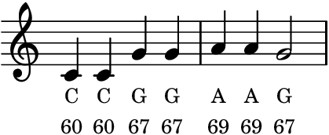

# Statistical Models

In this chapter, we will examine {vocab}`statistical models` in a computer music context: models that describe data, such as musical scores or recordings, in terms of probabilities and other statistics. Statistical models are among the most rudimentary algorithms for machine learning, which builds models from examples rather than from rules written by hand. Accordingly, some of the principles in this chapter underlie modern AI systems that learn from large datasets, not only for music but also for language. We will study those systems in [Chapter 18](../18-music-ai). Here, we focus on two simpler use cases for statistical models: _algorithmic composition_ and _voice modeling_.

:::{margin}
Pärt named the technique after the Latin word for bells. You can hear it in pieces like [_Für Alina_](https://en.wikipedia.org/wiki/F%C3%BCr_Alina) (1976) and [_Spiegel im Spiegel_](https://en.wikipedia.org/wiki/Spiegel_im_Spiegel) (1978).
:::

**Algorithmic composition.** A primary use case for statistical models is {vocab}`algorithmic composition`, the idea of generating musical scores with an algorithmic process. For example, the code below implements a simplified version of _tintinnabuli_, a compositional technique developed by Arvo Pärt. A melody moves step by step through a scale. A second voice accompanies each note of the melody with the nearest note above it from a chord of three notes, A, C, and E (in any octave). The result is a slowly unfolding series of bell-like harmonies. (We render it with `pluck`, a plucked string instrument that we will use throughout this chapter.)

:::{interactive}[notebooks/algorithmic-composition.ipynb]
:::

No matter how many times we run this code, it composes the same score. It is {vocab}`deterministic`. In this chapter, we will instead study {vocab}`stochastic` techniques, which center around _probability_, and whose outputs may change every time we run them. Specifically, we will study _Markov chains_ and $n$-gram models, whose probabilities are configured based on statistics extracted from musical examples.

**Voice modeling.** Similar statistical methods apply to audio, not just scores. At the end of this chapter, we will see how a technique called _linear predictive coding_ extracts statistics from a recording of the human voice, and uses them to design a filter that imitates it:

:::{audio-list}
{audio}`A sung vowel <./assets/vowel-a.wav>`

{audio}`The same vowel, synthesized by linear predictive coding <./assets/audio-vowel-a-lpc.wav>`

A voice singing the vowel "A" at $110$ Hz, and the same vowel synthesized from its statistics. Recording from Freesound: [368728](https://freesound.org/s/368728/) by antoinevg, License: [CC0](http://creativecommons.org/publicdomain/zero/1.0/).
:::

## Probability in music

The algorithmic composition techniques in this chapter require an initial leap of faith: that composing music can be viewed as a _probabilistic_ process. Before we take this leap, we need a few concepts from probability.

At the core of probability is the {vocab}`random variable`, a variable whose value is the outcome of a random process. In this chapter, we will primarily study random variables that have a finite set of possible outcomes, such as the six faces of a die, or a set of musical pitches. A _categorical distribution_ describes the probability of each outcome:

:::{prf:definition} Categorical distribution
:label: def-categorical
Let $X$ be a random variable whose possible outcomes form a finite set $\mathcal{X}$, called its {vocab}`alphabet`. A {vocab}`categorical distribution` assigns a probability $P(X = x) \in [0, 1]$ to each outcome $x \in \mathcal{X}$, such that the probabilities sum to one:

$$\sum_{x \in \mathcal{X}} P(X = x) = 1.$$
:::

When it is clear which random variable we mean, we will often abbreviate $P(X = x)$ as $P(x)$.

:::{prf:example} A fair die
:label: ex-fair-die
The roll of a fair, six-sided die is a random variable with the alphabet $\mathcal{X} = \{1, 2, 3, 4, 5, 6\}$. Every outcome is equally likely, so $P(x) = \frac{1}{|\mathcal{X}|} = \frac{1}{6}$ for every $x \in \mathcal{X}$, where $|\mathcal{X}|$ is the number of outcomes in the alphabet.
:::

The code below simulates rolls of this die with NumPy's `np.random.choice`, which takes an alphabet and its probabilities. Ten rolls look fairly arbitrary, but over six thousand rolls, each face comes up about one thousand times:

:::{interactive}[notebooks/dice.ipynb]
:::

Try loading the die, by setting `weights[-1] = 5.0` before the division. How often does a $6$ come up now?

### Stochastic processes

A categorical distribution models a single outcome. But a musical score contains a _sequence_ of notes:

:::{prf:definition} Stochastic process
:label: def-stochastic-process
A {vocab}`stochastic process` is a sequence of random variables, $X_1, X_2, \ldots, X_N$. Each random variable $X_i$ has its own alphabet $\mathcal{X}_i$ and distribution, which may depend on its position $i$ in the sequence.
:::

For a stochastic process, we abbreviate $P(X_i = x_i)$ as $P(x_i)$.

:::{prf:example} A pentatonic melody
:label: ex-pentatonic
Here is a basic stochastic process that composes a melody of $N$ notes. Every position uses the same alphabet of five pitches, $\mathcal{X}_i = \{60, 62, 64, 67, 69\}$ (the notes C, D, E, G, and A, which form a [_pentatonic scale_](https://en.wikipedia.org/wiki/Pentatonic_scale)), and every pitch is equally likely:

$$P(X_i = x) = \frac{1}{|\mathcal{X}_i|} = \frac{1}{5} \quad \text{for all } x \in \mathcal{X}_i.$$

A distribution like this one, in which every outcome is equally likely, is called {vocab}`uniform`.
:::

How do we generate a melody from this process? We draw a {vocab}`sample` of each random variable according to its distribution:

$$x_1 \sim P(X_1), \quad x_2 \sim P(X_2), \quad \ldots, \quad x_N \sim P(X_N),$$

where $x_i \sim P(X_i)$ means that the outcome $x_i$ is drawn at random with the probabilities of $X_i$. In this simple process, each $X_i$ is drawn _independently_, without regard to the outcomes of the others, so we could just as well draw them in any order, or all at once. (Later in this chapter, we will study processes in which each outcome depends on the outcomes before it.)

These $N$ pitches do not yet make a score, though. We also need to decide _when_ to play each note, and for how long. The {vocab}`inter-onset interval` (IOI) is the amount of time between the onsets of consecutive notes, and the _duration_ is the amount of time that each note lasts. When the duration exceeds the IOI, consecutive notes overlap.

The code below implements this process, with an IOI of a quarter of a beat at $120$ BPM, and prints the first four events of the score that it generates:

:::{interactive}[notebooks/uniform.ipynb]
:::

### Musical dice games

One of the earliest examples of algorithmic composition is the _musical dice game_ (in German, _Musikalisches Würfelspiel_), which was popular in 18th-century Europe. A composer would write many interchangeable snippets of a score, usually one {vocab}`measure` (a short span with a fixed number of beats) each. Players would then roll dice to choose which snippet to play at each position in a piece.

:::{margin}
Mozart's name appears on an edition of this game published in 1793, after his death. But an earlier edition from around 1790 names no composer at all.
:::

The most famous of these games ([K. 516f](https://imslp.org/wiki/Musikalisches_W%C3%BCrfelspiel,_K.516f_(Mozart,_Wolfgang_Amadeus))) is often attributed to Mozart, though the attribution is unconfirmed. Published in the 1790s, it contains $176$ one-measure snippets for a short waltz in $16$ measures, along with a table that assigns $11$ of the snippets to each of the $16$ measures. For each measure, the player rolls two dice, and looks up the snippet for their sum, from $2$ to $12$:

:::{figure}
![A grid of nine snippets of music notation, each one measure long, with a treble staff and a bass staff. The three columns are measures 1, 2, and 3 of the waltz, and the three rows are the dice sums S = 2, 3, and 4, labeled with their probabilities, 3%, 6%, and 8%, and with pictures of the rolls of two dice that give each sum: one roll for 2, two for 3, and three for 4. Ellipses show that the grid continues to the right and downward. Red boxes highlight one snippet in each column, for the sums 4, 2, and 3, connected by dashed red arrows.](./assets/fig-dice-game.png)

The first three measures of the dice game attributed to Mozart, for the dice sums $S = 2$, $3$, and $4$ (out of $2$ through $12$). Each roll of the dice picks one snippet for its measure. Here, the rolls are $4$, then $2$, then $3$.
:::

:::{prf:example} The sum of two dice
:label: ex-two-dice
The sum of two dice, $S$, is itself a categorical random variable, but its distribution is not uniform. Each die has $6$ equally likely faces, so a pair of dice has $6 \cdot 6 = 36$ equally likely outcomes. Of these, only one, $(1, 1)$, sums to $2$, while six sum to $7$. So $P(S = 2) = \frac{1}{36} \approx 3\%$, but $P(S = 7) = \frac{6}{36} \approx 17\%$.
:::

:::{figure} ./assets/fig-dice-sums.png
:name: fig-dice-sums
:alt: A bar chart of the probability of each sum of two dice, from 2 to 12. The bars rise in a straight line from 1/36 at a sum of 2 to a peak of 6/36 at a sum of 7, and then fall in a straight line back to 1/36 at a sum of 12.

The distribution of the sum $S$ of two fair dice.
:::

**In stochastic processes, some outcomes can be much more likely than others.** Because each roll of the dice has no effect on the others, the probability of a particular sequence of rolls is the product of the probabilities of its $16$ rolls. For example, rolling a $7$ for every measure has probability $\left(\frac{1}{6}\right)^{16} \approx 3.5 \times 10^{-13}$, while rolling a $2$ for every measure has probability $\left(\frac{1}{36}\right)^{16} \approx 1.3 \times 10^{-25}$. With $11^{16} \approx 4.6 \times 10^{16}$ possible sequences of rolls, both are astronomically unlikely. But rolling a $2$ for every measure is about three trillion ($6^{16} \approx 2.8 \times 10^{12}$) times less likely than rolling a $7$ for every measure.

The widget below, inspired by an [online version](https://dice.humdrum.org/) of the game, lets you play it. Each column is one of the $16$ measures (M1 through M16), and each row is one possible sum of the dice. Click a snippet to choose it, or roll the dice for every measure at once, and then listen to your waltz:

:::{interactive}[notebooks/dice-game.ipynb]
:::

Score data from the 1793 edition (public domain), based on the [Humdrum encoding](https://github.com/craigsapp/Musikalisches-Wuerfelspiel) by Craig Sapp, Daniel Shanahan, and Mauricio Rodriguez.

## n-gram statistics

In the previous section, we saw that we can use probabilities and stochastic processes to generate scores. But can we go the other way, and use scores to _induce_ stochastic processes? Let's build up some intuition for this question with a running example from [Chapter 4](../04-score-timbre), the first phrase of _Twinkle, Twinkle, Little Star_:

:::{figure}


The first phrase of _Twinkle, Twinkle, Little Star_, with the name and MIDI pitch of each note.
:::

As a {pyquist}`Score`, with times in beats, and leaving out durations for simplicity:

```python
twinkle = pq.Score([
    (0, {"pitch": 60}),
    (1, {"pitch": 60}),
    (2, {"pitch": 67}),
    (3, {"pitch": 67}),
    (4, {"pitch": 69}),
    (5, {"pitch": 69}),
    (6, {"pitch": 67}),
])
```

Consider a stochastic process with $N = 7$ notes, in which every $X_i$ has the same alphabet of six pitches, $\mathcal{X} = \{60, 62, 64, 65, 67, 69\}$ (C, D, E, F, G, and A), and the same uniform distribution, $P(X_i = x) = \frac{1}{6}$. What is the {vocab}`likelihood` of our melody, the probability that running this process generates it? In this process, each note is drawn independently of the others, so the probability of the whole sequence is the product of the probabilities of its notes:

$$
P(X_1 = 60) \cdot P(X_2 = 60) \cdot P(X_3 = 67) \cdot \ldots \cdot P(X_7 = 67) = \left(\frac{1}{6}\right)^7 = \frac{1}{279{,}936}.
$$

We would expect to run this process $279{,}936$ times before it generates our melody even once.

What happens if we change the stochastic process? Suppose that we instead use the alphabet $\mathcal{X} = \{60, 67, 69\}$, just the three pitches of our melody, each with probability $\frac{1}{3}$. Now the likelihood of our melody is $\left(\frac{1}{3}\right)^7 = \frac{1}{2187}$, which is $\frac{279{,}936}{2187} = 128$ times more likely than before. **By modifying the process to better reflect the "data", we improve the likelihood that it generates the sequences we are interested in.**

### Unigrams

How might we modify our process to be _even more likely_ to generate our melody? Specifically, what alphabet and probabilities would _maximize_ the likelihood of the melody? Intuitively, the probabilities that maximize the likelihood of a sequence are exactly the ones that reflect its _statistics_. Our alphabet should contain only the pitches of the sequence, and the probability of each pitch should be the fraction of the sequence that it makes up. This gives us a new stochastic process. Like our first one, it draws each of the $N$ notes independently, from the same distribution, but now that distribution reflects the melody:

$$P(X_i = x) = \frac{\text{count}(x)}{N} \quad \text{for all } i.$$

The first phrase of _Twinkle, Twinkle, Little Star_ (C C G G A A G, or $60, 60, 67, 67, 69, 69, 67$) contains $60$ twice, $67$ three times, and $69$ twice. So $P(X_i = 60) = \frac{2}{7}$, $P(X_i = 67) = \frac{3}{7}$, and $P(X_i = 69) = \frac{2}{7}$, and the likelihood of the melody is now

$$\frac{2}{7} \cdot \frac{2}{7} \cdot \frac{3}{7} \cdot \frac{3}{7} \cdot \frac{2}{7} \cdot \frac{2}{7} \cdot \frac{3}{7} = \frac{432}{823{,}543} \approx \frac{1}{1906}.$$

For a process that draws every note independently from the same distribution, this is the best we can do (we have maximized the likelihood). This basic strategy, counting how often each outcome occurs to model a sequence of outcomes, is known as a {vocab}`unigram` model, for reasons that will become clear shortly. The code below fits a unigram model to our melody by counting, and generates seven notes from it. The generated melodies have pitches in the right proportions, but in a random order:

:::{interactive}[notebooks/unigram.ipynb]
:::

### Markov chains

In a unigram model, every position has the same probabilities, and each choice is _independent_ of the others: knowing the previous note tells us nothing about the next one. This assumption is unwieldy for music, where notes relate to one another in time. For example, in many melodies, each note tends to be close in pitch to the note before it. To capture relationships like this, we need the notion of _conditional probability_:

:::{prf:definition} Conditional probability
:label: def-conditional-probability
The {vocab}`conditional probability` $P(X = x \mid Y = y)$ is the probability that a random variable $X$ takes the value $x$, given that we know that a random variable $Y$ took the value $y$. For each value $y$, it is a categorical distribution over the outcomes of $X$. If $P(X = x \mid Y = y) = P(X = x)$ for all $x$ and $y$, then knowing $Y$ tells us nothing about $X$, and we say that $X$ and $Y$ are {vocab}`independent`.
:::

With conditional probability in hand, we can define a stochastic process whose outcomes depend on one another:

:::{prf:definition} Markov chain
:label: def-markov-chain
A {vocab}`Markov chain` is a stochastic process in which the distribution of each outcome depends on the previous outcome. It consists of (1) a set of {vocab}`states`, its alphabet $\mathcal{X}$, and (2) the {vocab}`transition probabilities` $P(X_i = b \mid X_{i-1} = a)$ of moving from each state $a$ to each state $b$.
:::

We can draw a Markov chain as a graph, with a node for each state and an arrow for each transition, labeled with its probability. We can also write its transition probabilities as a {vocab}`transition matrix` $T \in [0, 1]^{|\mathcal{X}| \times |\mathcal{X}|}$ (the weighted adjacency matrix of the graph), whose rows are previous states, and whose columns are next states:

$$T_{a, b} = P(X_i = b \mid X_{i-1} = a).$$

For example, here is a Markov chain with two states, the notes C and G. When the previous note is C, the next note is C with probability $\frac{1}{3}$, and G with probability $\frac{2}{3}$. When the previous note is G, the next note is always C:

:::{figure}


A Markov chain with two states, drawn as a graph (left), and as a transition matrix (right). Rows are previous states, and columns are next states.
:::

Each row of the transition matrix is a categorical distribution over the next state, so it sums to one: $\sum_{b \in \mathcal{X}} T_{a, b} = 1$ for every state $a$.

The Markov chain is the first stochastic process we have studied whose **behavior depends on context**: the probabilities of each note depend on the note before it. But how much context does it use? Only the previous state. Given $X_{i-1}$, a Markov chain assumes that the next state $X_i$ is independent of all of the states before it, $X_1, \ldots, X_{i-2}$:

$$P(x_i \mid x_1, \ldots, x_{i-1}) = P(x_i \mid x_{i-1}).$$

This is called the {vocab}`Markov assumption`.

To generate from a Markov chain, we draw the first state from some distribution, for example, uniformly at random. Then we repeatedly draw the next state from the row of the transition matrix for the current state, $x_i \sim P(X_i \mid X_{i-1} = x_{i-1})$. The animation below shows this process for a Markov chain with three states, C, G, and A. At each step, the transitions out of the current state light up, one of them is drawn at random, and the new state joins the generated sequence, along with its probability:

:::{animation}[notebooks/markov-anim.ipynb]
:::

The code below implements this process, for a Markov chain whose $12$ states are the white keys of a piano from C4 to G5. Rather than learning its transition probabilities from data, we engineered them by hand, using some basic musical knowledge. Melodies tend to move to a neighboring note, sometimes jump a little further, and B tends to move up to C. Notice how sparse the transition matrix is: most of its entries are zero.

:::{interactive}[notebooks/markov.ipynb]
:::

### Fitting Markov chains to data

How should we set the transition probabilities of a Markov chain, to maximize the likelihood of a particular sequence? As for unigrams, the answer is to count. The transition probabilities that maximize the likelihood of a sequence are

$$P(X_i = b \mid X_{i-1} = a) = \frac{\text{count}(a \to b)}{\text{count}(a \to \cdot)},$$

where $\text{count}(a \to b)$ is the number of times that state $a$ is immediately followed by state $b$, and $\text{count}(a \to \cdot) = \sum_{b' \in \mathcal{X}} \text{count}(a \to b')$ is the number of times that $a$ is followed by any state.

Let's fit a Markov chain to the first phrase of _Twinkle, Twinkle, Little Star_, C C G G A A G. Its states are C, G, and A ($60$, $67$, and $69$), and it contains six transitions: C → C, C → G, G → G, G → A, A → A, and A → G. (The final G has no next note, so it does not count.) Each state is followed by two different states, once each. So every transition that occurs has probability $\frac{1}{2}$, and every other transition has probability $0$:

:::{figure}
![Left: a graph with three circular nodes, labeled C, G, and A. Each node has a loop back to itself labeled one half. An arrow from C to G is labeled one half, and arrows in both directions between G and A are labeled one half. Gray arrows labeled 0 lead from G to C, from C to A, and from A to C. Right: the same chain as a three-by-three table, with previous states C, G, and A as rows, and next states C, G, and A as columns. Row C reads one half, one half, 0. Rows G and A each read 0, one half, one half.](./assets/fig-markov-twinkle.png)

The Markov chain that maximizes the likelihood of the first phrase of _Twinkle, Twinkle, Little Star_, drawn as a graph (left, with transitions of probability $0$ in gray), and as a transition matrix (right).
:::

How should we choose the probability of the first note, $P(X_1)$? There are three reasonable options: (1) a uniform distribution, $P(X_1 = 60) = \frac{1}{|\mathcal{X}|} = \frac{1}{3}$, (2) the unigram probability, $P(X_1 = 60) = \frac{2}{7}$, or (3) always starting on the first note of the melody, $P(X_1 = 60) = 1$. Let's go with the third option. Then the likelihood of the melody is the probability of its first note, times the probability of each of its transitions:

$$P(X_1 = 60) \cdot P(X_2 = 60 \mid X_1 = 60) \cdot \ldots \cdot P(X_7 = 67 \mid X_6 = 69) = 1 \cdot \left(\frac{1}{2}\right)^6 = \frac{1}{64}.$$

That is about $30$ times more likely than under the unigram model ($\approx \frac{1}{1906}$). The code below fits this Markov chain by counting transitions, and generates melodies from it. The melodies mix and match pieces of the original, but once they leave C, they never return, since no transition leads back to it.

:::{interactive}[notebooks/markov-twinkle.ipynb]
:::

### n-grams

In music, we know intuitively that notes depend on _more_ than just the note immediately before them. For example, a melody that climbs C D E is likely to continue up to F, while a melody that falls G F E is likely to continue down to D, even though both just played E. How can we generalize Markov chains to longer contexts? First, we need a tool for computing the probability of a whole sequence:

:::{prf:definition} Chain rule of probability
:label: def-chain-rule
The probability that two random variables take the values $x$ and $y$ is the probability of the first, times the probability of the second given the first:

$$P(x, y) = P(x) \cdot P(y \mid x).$$

Applying this rule repeatedly, the probability of a sequence $x_1, \ldots, x_N$ is

$$
\begin{aligned}
P(x_1, \ldots, x_N) &= P(x_1) \cdot P(x_2 \mid x_1) \cdot P(x_3 \mid x_1, x_2) \cdot \ldots \cdot P(x_N \mid x_1, \ldots, x_{N-1}) \\
&= \prod_{i=1}^{N} P(x_i \mid x_1, \ldots, x_{i-1}),
\end{aligned}
$$

where the first factor ($i = 1$) has no condition, so it is just $P(x_1)$.
:::

The chain rule is exact: it makes no assumptions about the process. The models we have studied each simplify its factors. A unigram model ignores the context entirely, using $P(x_i)$ for each factor. A Markov chain keeps only the previous state, $P(x_i \mid x_{i-1})$, which is why its likelihood is the probability of its first state, times the probability of each transition.

An {vocab}`n-gram model` keeps the previous $n - 1$ states. Given these $n - 1$ states, it assumes that $X_i$ is independent of all earlier states:

$$P(x_i \mid x_1, \ldots, x_{i-1}) = P(x_i \mid x_{i-n+1}, \ldots, x_{i-1}).$$

:::{margin}
Be careful to distinguish $n$, the length of the context plus one, from $N$, the length of the sequence.
:::

Its name comes from {vocab}`n-grams`, subsequences of $n$ consecutive states. Once again, the probabilities that maximize the likelihood of a sequence come from counting:

$$P(b \mid a_1, \ldots, a_{n-1}) = \frac{\text{count}(a_1, \ldots, a_{n-1}, b)}{\text{count}(a_1, \ldots, a_{n-1}, \cdot)},$$

where $\text{count}(a_1, \ldots, a_{n-1}, b)$ is the number of times the $n$-gram $(a_1, \ldots, a_{n-1}, b)$ occurs in the sequence, and the denominator is the number of times its context $(a_1, \ldots, a_{n-1})$ is followed by any state.

The models we have seen are special cases. A unigram model is an $n$-gram model with $n = 1$ (no context at all), and a Markov chain has $n = 2$, which is why it is also called a {vocab}`bigram` model. With $n = 3$, we have a {vocab}`trigram` model, and so on.

Longer contexts come at a steep price. An $n$-gram model needs a probability for every possible context of $n - 1$ states, followed by every possible next state, for a total of $|\mathcal{X}|^n$ probabilities. This blows up very quickly. For example, a Markov chain over the $88$ keys of a piano has $88^2 = 7744$ probabilities, but a trigram model has $88^3 = 681{,}472$.

:::{margin}
This is an instance of the [curse of dimensionality](https://en.wikipedia.org/wiki/Curse_of_dimensionality). Modern AI language models are based on the same basic idea as $n$-gram models, predicting what comes next from its context. A key distinction is that they have mechanisms to overcome the curse of dimensionality, such as recognizing that similar contexts should lead to similar predictions.
:::

Meanwhile, the amount of data stays the same. A sequence of $N$ states contains just $N - n + 1$ $n$-grams, so as $n$ grows, more and more of the probabilities are zero. **The table gets sparser.** For example, here are the bigram and trigram counts for all six phrases of _Twinkle, Twinkle, Little Star_ ($N = 42$ notes). Just $14$ of the $36$ bigram counts ($38.9\%$) are nonzero, and just $18$ of the $216$ trigram counts ($8.3\%$):

:::{figure}


Bigram counts (left) and trigram counts (right) for all of _Twinkle, Twinkle, Little Star_. Shaded cells are nonzero.
:::

So we need to find a "Goldilocks" value of $n$. With $n = 1$, the model has no context at all. With $n = N$, the model has seen just one context, the first $N - 1$ states, so all it can do is copy the original sequence. More generally, **as $n$ grows, an $n$-gram model copies longer and longer passages of the sequence it was fit to.** In practice, $n = 2$ and $n = 3$ are often the sweet spots between no context and copying.

:::{margin}
In 1957, [Brooks, Hopkins, Neumann, and Wright](https://ieeexplore.ieee.org/document/5222016) fit $n$-gram models with up to $n = 8$ to a collection of $37$ melodies, and generated new melodies from them {cite}`brooks1957experiment`, an early example of the techniques in this section.
:::

The code below fits $n$-gram models to the melodies of three pieces, stored as MIDI files: all of _Twinkle, Twinkle, Little Star_, the first prelude of Bach's _The Well-Tempered Clavier_, and Koji Kondo's theme for _Super Mario Bros._ When a piece plays several notes at once, we keep only the highest:

:::{interactive}[notebooks/ngram.ipynb]
:::

Try different values of $n$, and listen for the transition from random to copying. For example, for the Bach prelude, when $n = 4$, about half of the generated stretches of $8$ notes appear verbatim in the original, and when $n = 6$, all of them do. But beware: the Bach prelude contains $32$ different pitches, so its table has $32^n$ entries. With $n = 5$, that is over $33$ million!

As a challenge, try rewriting `compute_ngram` to store its counts in a dictionary, whose keys are only the $n$-grams that actually occur, rather than in a dense array with an entry for every possible $n$-gram. How large can $n$ get now?

## Linear predictive coding

So far, we have applied statistical models to scores. Can we also apply them to waveforms? Not directly, since $n$-gram models over individual audio samples aren't particularly meaningful. With $16$-bit audio, the alphabet has $2^{16} = 65{,}536$ states, so even a bigram model would have $2^{32}$ probabilities, over four billion. And any tractable value of $n$ would capture only microseconds of context. At $f_s = 44{,}100$ Hz, a trigram model conditions on just two samples, about $45$ microseconds of audio.

Instead of using $n$-grams to generate audio, we can use a similar approach to _estimate filters_. Consider a feedforward filter ([Chapter 9](../09-filters)) that aims to _predict_ each sample of a signal $x$ from the $K$ samples before it:

$$\hat{x}[n] = h_1 \, x[n-1] + h_2 \, x[n-2] + \ldots + h_K \, x[n-K] = \sum_{k=1}^{K} h_k \, x[n-k].$$

Like an $n$-gram model, this filter uses a context of previous samples to predict the next one. But instead of a table of probabilities, it has just $K$ coefficients, $\mathbf{h} = [h_1, \ldots, h_K]$. How might we "learn" these coefficients from data?

:::{prf:definition} Linear predictive coding
:label: def-lpc
Given a signal $\mathbf{x} \in \mathbb{R}^N$ and an order $K$, {vocab}`linear predictive coding` (LPC) finds the coefficients $\mathbf{h} \in \mathbb{R}^K$ that minimize the total squared {vocab}`prediction error`, $e[n] = x[n] - \hat{x}[n]$:

$$\min_{\mathbf{h}} \sum_{n=K}^{N-1} e[n]^2 = \min_{\mathbf{h}} \sum_{n=K}^{N-1} \left(x[n] - \sum_{k=1}^{K} h_k \, x[n-k]\right)^2.$$
:::

This is a basic statistical model. It predicts the current sample as a linear combination of the previous $K$ samples, with coefficients that are fit to the statistics of the signal. Minimizing a sum of squared errors like this one is a classic problem called {vocab}`least squares`. To set it up, we stack the context of each sample into a row of a matrix $\mathbf{X} \in \mathbb{R}^{(N - K) \times K}$. Then the predictions for all of the samples at once are the matrix-vector product $\mathbf{X} \mathbf{h}$:

$$
\begin{bmatrix} \hat{x}[K] \\ \hat{x}[K+1] \\ \vdots \\ \hat{x}[N-1] \end{bmatrix}
=
\underbrace{\begin{bmatrix} x[K-1] & x[K-2] & \ldots & x[0] \\ x[K] & x[K-1] & \ldots & x[1] \\ \vdots & \vdots & \ddots & \vdots \\ x[N-2] & x[N-3] & \ldots & x[N-K-1] \end{bmatrix}}_{\mathbf{X}}
\begin{bmatrix} h_1 \\ h_2 \\ \vdots \\ h_K \end{bmatrix}.
$$

:::{margin}
For readers comfortable with linear algebra, least squares has a closed-form solution, $\mathbf{h} = (\mathbf{X}^\top \mathbf{X})^{-1} \mathbf{X}^\top \mathbf{y}$, where $\mathbf{y} = [x[K], \ldots, x[N-1]]$. In practice, solvers like `np.linalg.lstsq` compute it in more numerically stable ways.
:::

Numerical libraries have efficient solvers for least squares. For example, NumPy's `np.linalg.lstsq` finds the $\mathbf{h}$ that minimizes the squared difference between $\mathbf{X}\mathbf{h}$ and the true samples, $x[K], \ldots, x[N-1]$. The code below fits an LPC model with $K = 40$ to half a second of a sung vowel, and compares its predictions to the true samples. They are nearly indistinguishable:

:::{interactive}[notebooks/lpc.ipynb]
:::

Recording from Freesound: [368728](https://freesound.org/s/368728/) by antoinevg, License: [CC0](http://creativecommons.org/publicdomain/zero/1.0/).

### Inverse filtering

What can we do with an LPC model? Let's rearrange the definition of its prediction error:

$$e[n] = x[n] - \hat{x}[n] \quad \Longrightarrow \quad x[n] = e[n] + \hat{x}[n] = e[n] + h_1 \, x[n-1] + \ldots + h_K \, x[n-K].$$

This is a recursive filter ([Chapter 9](../09-filters)), whose input is the prediction error $e$, and whose output is the original signal $x$! So LPC splits a signal into two parts: (1) a filter, described by just $K$ coefficients, and (2) the prediction error, which is whatever the filter could not predict. A feedforward filter with the coefficients $[1, -h_1, \ldots, -h_K]$ turns $x$ into $e$, and a recursive filter with the same coefficients turns $e$ back into $x$. The two filters are inverses of each other. The code below confirms that this {vocab}`inverse filtering` recovers the original signal, up to tiny rounding errors, for a recording of the vowel "E":

:::{interactive}[notebooks/inverse-filter.ipynb]
:::

Notice that the prediction error is much quieter than the vowel. It is mostly noise, punctuated by a burst once every $9$ ms or so (the dashed lines), which is exactly the period of the vowel. To see why, let's take a closer look at the voice.

Recording from Freesound: [368727](https://freesound.org/s/368727/) by antoinevg, License: [CC0](http://creativecommons.org/publicdomain/zero/1.0/).

### Modeling vowels

The human voice is a natural fit for LPC. When we sing a vowel, our vocal folds vibrate, releasing a periodic series of puffs of air, called the {vocab}`glottal pulse train`. The rate of the pulses is the fundamental frequency $f_0$ of our voice, which sets its pitch, and the time between consecutive pulses is its fundamental period, $t_0 = \frac{1}{f_0}$. For the recordings in this section, $f_0 = 110$ Hz, so a pulse arrives every $t_0 = \frac{1}{110} \approx 9.1$ ms. Our throat and mouth then act as a filter, whose resonances, called {vocab}`formants`, depend on the shape of our mouth. The formants determine which vowel we hear. This is known as the _source-filter model_ of the voice.

LPC estimates this filter from a recording. Its prediction error contains whatever the filter cannot predict, which is approximately the glottal pulse train, a sharp pulse once per period. Each vowel gets a different filter, with formants at different frequencies:

:::{figure}


The spectra of five vowels sung at $110$ Hz (gray), and the frequency responses of their LPC filters, with $K = 40$ (color). Each filter traces the envelope of its vowel's harmonics. The peaks of the envelopes, the formants, differ from vowel to vowel.
:::

So to synthesize a vowel, we can replace the prediction error with a synthetic train of impulses, and pass it through the LPC filter. The pulse train sets the pitch, and the filter sets the vowel, so we can change one without changing the other. The code below fits an LPC filter to each of the five vowels, and uses them to sing the first phrase of _Twinkle, Twinkle, Little Star_, changing vowels from note to note (A A E E I O U). Each note is a pulse train at the pitch of the note, faded in and out, and passed through the filter of its vowel:

:::{interactive}[notebooks/vowels.ipynb]
:::

:::{margin}
LPC was developed in the late 1960s and 1970s for compressing speech {cite}`makhoul1975linear`. Since the filter changes slowly, transmitting a few coefficients per frame takes far fewer bits than transmitting every sample. We will study audio compression in [Chapter 16](../16-compression-midi).
:::

Recordings from Freesound by antoinevg, License: [CC0](http://creativecommons.org/publicdomain/zero/1.0/): A [368728](https://freesound.org/s/368728/), E [368727](https://freesound.org/s/368727/), I [368726](https://freesound.org/s/368726/), O [368725](https://freesound.org/s/368725/), and U [368729](https://freesound.org/s/368729/).

## Summary

- {vocab}`Algorithmic composition` generates scores with an algorithmic process. Deterministic processes always produce the same output, while stochastic processes center around probability.
- A {prf:ref}`categorical distribution <def-categorical>` assigns probabilities that sum to one to the outcomes of a finite {vocab}`alphabet`. A {vocab}`stochastic process` models a sequence of random outcomes, like the measures of a musical dice game.
- The {vocab}`likelihood` of a sequence is the probability that a process generates it. Fitting a process to data increases the likelihood of the data, and counting maximizes it.
- A {vocab}`unigram` model gives each outcome the fraction of the data that it makes up. A {vocab}`Markov chain` conditions each outcome on the previous one, with {vocab}`transition probabilities` $\frac{\text{count}(a \to b)}{\text{count}(a \to \cdot)}$ that form a {vocab}`transition matrix`.
- The {prf:ref}`chain rule <def-chain-rule>` factors the probability of a sequence. An {vocab}`n-gram model` conditions each outcome on the previous $n - 1$, with $|\mathcal{X}|^n$ probabilities. A longer context captures more structure, but the table grows exponentially and becomes sparser, until the model simply copies its data.
- {vocab}`Linear predictive coding` predicts each sample as a linear combination of the previous $K$ samples, fit by {vocab}`least squares`. {vocab}`Inverse filtering` splits a signal into a filter and a {vocab}`prediction error`. For a sung vowel, the filter models the {vocab}`formants`, and the prediction error approximates the {vocab}`glottal pulse train`, so we can resynthesize the vowel at any pitch.

## Questions for the reader

::::{exercise}
**Two dice.** In the musical dice game attributed to Mozart, each measure is chosen by the sum of two dice (see {numref}`fig-dice-sums`).

1. What is the probability that a measure uses the snippet for a sum of $7$?
1. What is the probability that it uses the snippet for a sum of $2$ or $12$?
1. What is the probability that every one of the $16$ measures uses a snippet for a sum of $6$, $7$, or $8$?

:::{solution}

1. $\frac{6}{36} = \frac{1}{6}$
1. $\frac{2}{36} = \frac{1}{18}$
1. $\left(\frac{4}{9}\right)^{16} \approx 2.3 \times 10^{-6}$

:::
::::

::::{exercise}
**Unigrams and Markov chains.** The first phrase of _Mary Had a Little Lamb_ is E D C D E E E, or $64, 62, 60, 62, 64, 64, 64$.

1. Fit a unigram model to this melody. What is the probability of each pitch?
1. What is the likelihood of the melody under this unigram model?
1. Fit a Markov chain to this melody. What is its transition matrix, with the states in the order C, D, E?
1. What is the likelihood of the melody under this Markov chain, if it always starts on E?

:::{solution}

1. $P(X_i = 60) = \frac{1}{7}$, $P(X_i = 62) = \frac{2}{7}$, and $P(X_i = 64) = \frac{4}{7}$
1. $\frac{1024}{823{,}543} \approx \frac{1}{804}$
1. $\begin{bmatrix} 0 & 1 & 0 \\ \frac{1}{2} & 0 & \frac{1}{2} \\ 0 & \frac{1}{3} & \frac{2}{3} \end{bmatrix}$
1. $\frac{1}{27}$

:::
::::

::::{exercise}
**Generating from a Markov chain.** A Markov chain has two states, C and G. C is followed by C with probability $\frac{1}{3}$, and by G with probability $\frac{2}{3}$. G is always followed by C.

1. Starting on C, what is the probability that the chain generates C G C C?
1. Can the chain ever generate G G? Why or why not?

:::{solution}

1. $\frac{2}{9}$
1. No, since the transition from G to G has probability $0$.

:::
::::

::::{exercise}
**The cost of context.** Consider $n$-gram models of melodies whose alphabet is the $12$ pitch classes, C, C♯, D, …, B.

1. How many probabilities does a trigram model have? How many does a $5$-gram model have?
1. How many trigrams does a melody of $N = 100$ notes contain?
1. If we fit a trigram model to this melody, at most what fraction of its probabilities can be nonzero?

:::{solution}

1. $1728$ and $248{,}832$
1. $98$
1. $\frac{98}{1728} \approx 5.7\%$

:::
::::

::::{exercise}
**Goldilocks.** You fit $n$-gram models to a single, long piece of music, and generate new melodies from them. Describe what you would expect to hear with $n = 1$, $n = 2$, and $n = 20$.

:::{solution}
With $n = 1$, the pitches of the piece in the right proportions, but in a random order. With $n = 2$, plausible steps from note to note that wander aimlessly. With $n = 20$, long passages copied verbatim from the piece.
:::
::::

::::{exercise}
**Linear prediction.** An LPC model of order $K = 1$ has the coefficient $h_1 = 0.9$.

1. For the signal $x = [1.0, 1.0, 0.5]$, what are the predictions $\hat{x}[1]$ and $\hat{x}[2]$, and the prediction errors $e[1]$ and $e[2]$?
1. Starting from $x[0] = 1.0$, use the recursive filter $x[n] = e[n] + h_1 \, x[n-1]$ and your prediction errors to recover $x[1]$ and $x[2]$.

:::{solution}

1. $\hat{x}[1] = 0.9$ and $\hat{x}[2] = 0.9$, so $e[1] = 0.1$ and $e[2] = -0.4$
1. $x[1] = 1.0$ and $x[2] = 0.5$

:::
::::

::::{exercise}
**Changing the pitch of a vowel.** You fit an LPC filter to a vowel sung at $110$ Hz, with $f_s = 44{,}100$ Hz. To resynthesize the same vowel at $220$ Hz, about how many samples apart should the impulses of your pulse train be? Should you change the filter?

:::{solution}
About $200$ samples. No, the filter sets the vowel, not the pitch.
:::
::::

::::{exercise}
**A musical Turing test.** Starting in 1981, the composer David Cope developed _Experiments in Musical Intelligence_ (EMI), a program that composes new music in the style of a given composer {cite}`cope1996experiments`. EMI analyzes a collection of the composer's pieces for the patterns that characterize them, and recombines fragments of those pieces into new ones. For each pair of excerpts below, one was composed by the human composer, and the other by EMI. Can you tell which is which? (This one is just for fun.)

:::{audio-list}
{audio}`Bartók, excerpt A <./assets/audio-turing-bartok-a.mp3>`

{audio}`Bartók, excerpt B <./assets/audio-turing-bartok-b.mp3>`

{audio}`Joplin, excerpt A <./assets/audio-turing-joplin-a.mp3>`

{audio}`Joplin, excerpt B <./assets/audio-turing-joplin-b.mp3>`

Two pairs of piano excerpts, in the styles of Béla Bartók and Scott Joplin.
:::

:::{solution}
Bartók: A is Bartók's _Allegro barbaro_ (1911), and B is EMI's _Kosmos (after Bartók)_. Joplin: A is EMI's _Rag (after Joplin)_, and B is Joplin's _Weeping Willow_ (1903).
:::
::::

## Musical examples

### Lejaren Hiller and Leonard Isaacson - _Illiac Suite_ (1957)

The _Illiac Suite_ for string quartet is one of the first pieces of music composed by a computer, the ILLIAC I at the University of Illinois. Each of its four movements, or "experiments", explores a different algorithmic technique {cite}`hiller1959experimental`. The fourth experiment composes with Markov chains, whose transition probabilities Hiller and Isaacson designed by hand, rather than fitting them to data. For example, one of their chains favors small steps between consecutive notes, while another favors consonant intervals.

<iframe width="560" height="315" src="https://www.youtube-nocookie.com/embed/QyqiSbbwHIs" title="YouTube video player" frameborder="0" allow="accelerometer; autoplay; clipboard-write; encrypted-media; gyroscope; picture-in-picture; web-share" referrerpolicy="strict-origin-when-cross-origin" allowfullscreen></iframe>

### Philippe Manoury - _Pluton_ (1988)

In _Pluton_, for piano and live electronics, the computer listens to the pianist, and builds Markov chains from the notes they play, in real time. The chains then generate new music in the style of what the pianist just played, which the computer plays back by transposing recordings of the piano, captured on the fly. _Pluton_ was the first piece made with Max, the visual programming language for computer music that Miller Puckette developed at IRCAM.

<iframe width="560" height="315" src="https://www.youtube-nocookie.com/embed/p9TPlYCp5ps?start=310" title="YouTube video player" frameborder="0" allow="accelerometer; autoplay; clipboard-write; encrypted-media; gyroscope; picture-in-picture; web-share" referrerpolicy="strict-origin-when-cross-origin" allowfullscreen></iframe>

### David Cope - _Mazurka, Op. 1, No. 2 (after Chopin)_ (1997)

David Cope's _Experiments in Musical Intelligence_ (EMI) composed new pieces in the styles of composers from Bach to Joplin, by recombining fragments of their works that respect the patterns characteristic of each composer. This mazurka, a Polish dance form, imitates Chopin, who wrote dozens of them. In this recording, Mary Jane Cope performs it on the piano. Some listeners have mistaken EMI's imitations for the real thing.

<iframe width="560" height="315" src="https://www.youtube-nocookie.com/embed/wk-Zmqs4avE" title="YouTube video player" frameborder="0" allow="accelerometer; autoplay; clipboard-write; encrypted-media; gyroscope; picture-in-picture; web-share" referrerpolicy="strict-origin-when-cross-origin" allowfullscreen></iframe>

### Autechre - _Untitled_ (2022)

Markov chains with hand-designed probabilities are still a tool of modern electronic music. For example, the duo Autechre is known for generative rhythms programmed in Max. In this untitled demo from 2022, a sparse transition table mostly follows a fixed rhythmic pattern, but encodes a few jumps that occasionally send the rhythm somewhere unexpected.

<iframe width="560" height="315" src="https://www.youtube-nocookie.com/embed/3poN6FDyB28" title="YouTube video player" frameborder="0" allow="accelerometer; autoplay; clipboard-write; encrypted-media; gyroscope; picture-in-picture; web-share" referrerpolicy="strict-origin-when-cross-origin" allowfullscreen></iframe>
