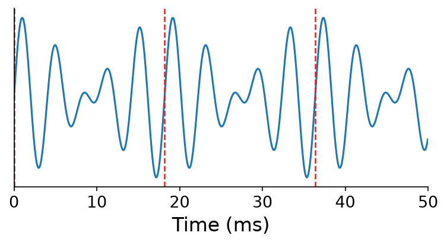
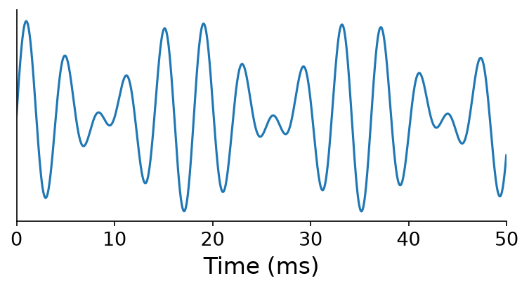

# Compression and MIDI

In {ref}`Chapter 7 <sec-quantization-decibels>`, we studied how to convert analog sound into digital audio that is indistinguishable from the original to human ears. To accomplish this, we exploited two limitations of human hearing. We can only hear frequencies up to about $20$ kHz, so a sample rate a bit above $40$ kHz suffices. Additionally, we can only distinguish amplitudes across a dynamic range of about $100$ dB in ordinary settings, so $16$ bits per sample suffice. Through these mechanisms, we _compressed_ analog sound, a continuous function with infinite resolution, down to a finite amount of information.

Are these the only limitations of our hearing? And if not, can we exploit the others to compress sound even further? In this chapter, we will study these questions. Along the way, we will learn how the audio formats we encounter every day (WAV, MP3, FLAC, and MIDI) store musical information, and why they make such different decisions about what to keep.

## Codecs

A primary goal of this chapter is to design {vocab}`codecs`. The word is a portmanteau of _coder_ and _decoder_, the two halves of every codec:

- A {vocab}`coder` is a function that compresses audio $\mathbf{x}$ into some discrete set of codes, for example, a string of bits.
- A {vocab}`decoder` is a function that reconstructs audio from those codes. It aims to be the inverse of the coder.

Passing audio through the coder and then the decoder, $\text{Decoder}(\text{Coder}(\mathbf{x}))$, is called a {vocab}`round trip`:

:::{figure}


A codec. The coder compresses audio into codes, and the decoder reconstructs audio from the codes. The distortion compares the original audio to its round trip.
:::

We have already studied one codec, without referring to it as such. **Digital audio itself is a "codec" for analog sound.** The analog-to-digital converter (sampling, then quantization) is the coder, and its codes are the integers of a digital audio file. The digital-to-analog converter is the decoder.

(sec-rate-distortion)=

### Rate and distortion

Codec design has two goals that are fundamentally in tension with one another:

1. Minimize the {vocab}`information rate`, the number of bits that the codes take up per second of audio:

   $$\text{rate} = \frac{\texttt{size}(\text{Coder}(\mathbf{x}))}{T} \quad \left[{unit}`bits,second`\right],$$

   where $T$ is the duration of $\mathbf{x}$ in seconds.

1. Minimize the {vocab}`distortion`, some measurement of error between the input $\mathbf{x}$ and its round trip:

   $$\text{distortion} = \texttt{error}\big(\mathbf{x}, \text{Decoder}(\text{Coder}(\mathbf{x}))\big).$$

For example, consider CD-quality digital audio as a codec. It stores $44{,}100$ samples per second for each of $2$ channels (stereo), at $16$ bits per sample. Working through the units, its rate is

CLAUDE: units of 44100 should be samples per second _per channel_, right? otherwise the "channel" unit doesn't cancel out leaving w/ bits per second. any reasonable way to represent this? shuold also change order of multiplication to multiply by channels first before bits per sample
$$44{,}100 \left[{unit}`samples,second`\right] \cdot 16 \left[{unit}`bits,sample`\right] \cdot 2 \;\text{channels} = 1{,}411{,}200 \left[{unit}`bits,second`\right],$$

or about $1411$ kilobits per second (kbps). Since we sample at $f_s > 2 f_{\max}$, sampling itself is lossless (by the Nyquist-Shannon sampling theorem). So the only distortion of this codec is the quantization noise we studied in {ref}`Chapter 7 <sec-quantization-decibels>`, which is about $96$ dB below full scale, and imperceptible.

CLAUDE: need to note at some point around here that we will occasionally refer to compression factor: which is $\frac{size(x)}{size(Coder(x))}$. for digital audio as input, numerator is 1411 kbps, and demoninator is codec output in kbps.

In this chapter, we will study the compression algorithms underlying several audio encodings (PCM and $\mu$-law) and file formats (MP3, FLAC, and MIDI). These make very different tradeoffs between rate and distortion:

CLAUDE: this is the right idea, but let's sharpen this a bit. (1) make it more of a square plot than a wide one. (2) make the "better" line go all the way from top right to bottom left, perhaps make it dashed as well, (3) FLAC and WAV should be down at "None"... the "input" here is digital PCM audio, not analog sound (quantization noise is not considered distortion in this context, might need to change the text above/around to clarify this). MP3 should still reach imperceptible but not none. (4) None shuold be labeled as None (Lossless)
:::{figure}
![A scatter plot with information rate in kilobits per second on a logarithmic horizontal axis, from 0.1 to over 1000, and distortion on the vertical axis, with four levels from bottom to top: none, imperceptible, perceptible, and only the score survives. PCM (16-bit WAV) sits at about 1411 kbps with imperceptible distortion. FLAC is a short bar from about 700 to 1000 kbps, also imperceptible. Mu-law (8-bit) sits at about 700 kbps, between imperceptible and perceptible. MP3 is a diagonal bar from 320 kbps with imperceptible distortion down to 64 kbps with perceptible distortion. MIDI is a bar from 0.1 to 1 kbps at the top level, only the score survives. An arrow labeled better points toward the bottom left corner.](./assets/fig-rate-distortion.png)

Approximate rates and distortions of the formats in this chapter, for stereo music. Distortion is measured relative to the original analog sound, so FLAC, which perfectly reconstructs 16-bit PCM, inherits its imperceptible quantization noise. Lower is better on both axes.
:::

CLAUDE: I like making codecs its own section, but this material should come in the intro, not at the end of the codecs section
Here is our plan for the chapter. We will start by studying additional aspects of _psychoacoustics_, our perception of sound, that suggest new mechanisms for compression. Next, we will discuss strategies for amplitude quantization that are more sophisticated than those of {ref}`Chapter 7 <sec-quantization-decibels>`. After that, we will discuss _lossy_ and _lossless_ codecs for digital audio, which form the basis of formats like MP3 and FLAC, respectively. Finally, we will discuss the MIDI format, and its relationship to _semantic compression_.

## Psychoacoustics

_Acoustics_ concerns the _physics_ of sound in the natural world. {vocab}`Psychoacoustics` concerns our _perception_ of sound. How does our perception relate to the physics? Let's start with two dimensions that we have studied closely: _frequency_ and _amplitude_. Our perceptions of _pitch_ and _loudness_ are roughly proportional to the _logarithms_ of their physical counterparts:

$$\text{pitch} \propto \log(\text{frequency}), \qquad \text{loudness} \propto \log(\text{amplitude}).$$

:::{margin}
In 1860, Gustav Fechner proposed that perceived intensity grows with the logarithm of physical intensity, building on Ernst Weber's observation that we notice changes in proportion to the starting intensity. This is known as the [Weber-Fechner law](https://en.wikipedia.org/wiki/Weber%E2%80%93Fechner_law).
:::

These logarithmic relationships are not limited to hearing. They are a common phenomenon across our senses, for example, our perception of the brightness of light and the heaviness of weights.

Why might this be the case? One hypothesis is that the sounds of our everyday environment are spread fairly evenly across this logarithmic space. They range from about $20$ Hz to $20{,}000$ Hz (three orders of magnitude) in frequency, and from about $0$ dB SPL to $120$ dB SPL (six orders of magnitude) in pressure. A logarithmic perception may have evolved to put all of these sounds on a level playing field. For example, the familiar sounds below span the whole space, when frequency is drawn in octaves and amplitude in decibels (hover over each one for its name):

CLAUDE: this shuold be a static figure w/ labels, not a notebook. maybe also consider showing a side-by-side comparison in linear units as well, to show how unevenly it is distroibuted
:::{interactive}[notebooks/audiogram.ipynb]
:::

The placements are approximate, since each sound spans a range of frequencies and levels. Next, let's take a closer look at each of these two dimensions.

### Perception of amplitude

We first studied our perception of amplitude when we introduced the decibel in {ref}`Chapter 7 <sec-quantization-decibels>`. As a reminder, the decibel measures an amplitude $a$ relative to a reference amplitude $a_0$:

$$\text{dB} = 20 \log_{10}\!\left(\frac{a}{a_0}\right).$$

We will use two conventions for the reference:

- dBFS (decibels relative to full scale) uses the loudest amplitude that a digital system can represent, $a_0 = 1$ (unitless). Well-behaved digital audio has negative dBFS values.
- dB SPL (sound pressure level) uses the quietest pressure that a human can perceive, $p_0 = 20$ μPa, so $\text{dB SPL} = 20 \log_{10}(p / p_0)$. Perceivable sounds have positive dB SPL values.

How much dynamic range do your own ears have? The test below estimates it (note: this is not a proper hearing test and is sensitive to your current listening environment). **Put in your headphones and start with your volume low.** First, press the $-3$ dB and $+3$ dB buttons until the reference tone ($1000$ Hz) is loud, but not uncomfortable. Then, press start, and answer whether you hear each tone. Behind the scenes, the test uses a binary search to find the quietest level you can hear:

CLAUDE: this is neat... why are we quantizing to 16 bit though? just use 32b float. use pq.play(pq.Audio(...)). also, in the test, I heard the lowest dB I could hear as sort of buzzing, which indicates maybe it was being corrupted by quantization noise? this might be because of the 16b stuff, but not sure what was going on there. also, the text at the end of the test w/ all the caveats was too much, say less pls.
:::{interactive}[notebooks/dynamic-range-test.ipynb]
:::

Your result depends on your ears, but also on your headphones, your volume setting, and the background noise of your room. In a quiet room with good headphones, some listeners will reach the floor of the $16$-bit audio that this page plays, about $-96$ dBFS, below which every sample rounds to zero.

### Perception of frequency

The range of human hearing in frequency is roughly $20$ Hz to $20$ kHz. This range varies across species. For example, elephants can hear (and produce) sounds well below $20$ Hz, dogs can hear up to about $45$ kHz, and some bats can hear up to about $200$ kHz.

Within this range, our perception of pitch is organized around the {vocab}`octave`, a doubling of frequency, as we discussed in [Chapter 4](../04-score-timbre). How many octaves does human hearing span? If $N$ is the number of octaves, then

$$20 \cdot 2^N = 20{,}000 \implies 2^N = 1000 \implies N = \log_2(1000) \approx 10.$$

Here are tones at each octave from $20$ Hz upwards. Many headphones and laptop speakers can't reproduce the lowest few, and many listeners (especially adults) can't hear the highest:

CLAUDE: attenuate all of these slightly w.r.t. fletcher-munson equal loudness (Don't mention fletcher-munson at this point to the reader, just do this behind hte scenes). as one calibration data point, 1280Hz is comfortable right now at the current peak amplitude, but 5120 Hz is screaming loud and uncomfortable.
:::{audio-list}
{audio}`20 Hz <./assets/audio-octave-00020.wav>`

{audio}`40 Hz <./assets/audio-octave-00040.wav>`

{audio}`80 Hz <./assets/audio-octave-00080.wav>`

{audio}`160 Hz <./assets/audio-octave-00160.wav>`

{audio}`320 Hz <./assets/audio-octave-00320.wav>`

{audio}`640 Hz <./assets/audio-octave-00640.wav>`

{audio}`1280 Hz <./assets/audio-octave-01280.wav>`

{audio}`2560 Hz <./assets/audio-octave-02560.wav>`

{audio}`5120 Hz <./assets/audio-octave-05120.wav>`

{audio}`10240 Hz <./assets/audio-octave-10240.wav>`

{audio}`20480 Hz <./assets/audio-octave-20480.wav>`

Sine tones spaced by octaves, spanning the range of human hearing, at $-18$ dBFS.
:::

CLAUDE: add note that headphones with active noise cancelation (e.g. airpods) should not be used for this test, as their noise cancelation can unintentionally distort the test signals
What is the highest frequency that you can hear? The test below estimates it, again with a binary search. As before, put in your headphones, set the reference tone ($1000$ Hz) to a comfortable level, and then answer whether you hear each tone:

:::{interactive}[notebooks/frequency-range-test.ipynb]
:::

The upper limit of hearing declines with age, typically starting in our twenties. And as with the previous test, your headphones or speakers may roll off before your ears do.

(sec-equal-loudness)=

### Equal-loudness contours

Psychoacoustics goes well beyond the logarithmic relationships of pitch and loudness to frequency and amplitude. For example, these dimensions also _interact_ with one another. **Two tones with the same amplitude, but different frequencies, can have very different perceived loudness.**

{vocab}`Equal-loudness contours` describe these interactions. They chart the perceived loudness of a sine tone, measured in a unit called the {vocab}`phon`, as a function of both its frequency and its sound pressure level (in dB SPL). Each contour connects the frequency and level combinations that listeners perceive as equally loud. They were first measured by Harvey Fletcher and Wilden Munson in 1933 {cite}`fletcher1933loudness`, and are sometimes called _Fletcher-Munson curves_. The contours below are from a more recent international standard {cite}`iso2262003`:

:::{figure}
![Six curves of sound pressure level in dB SPL versus frequency from 20 Hz to 12.5 kHz on a logarithmic axis. A dashed gray curve, the threshold of hearing, falls from about 78 dB SPL at 20 Hz to about 2 dB SPL at 1 kHz, dips to a minimum of about minus 6 dB SPL near 3 to 4 kHz, and rises again above 6 kHz. Five blue curves for 20, 40, 60, 80, and 100 phons follow the same general shape at increasing levels, each passing through its own number of dB SPL at 1 kHz, and each flatter than the curve below it.](./assets/fig-equal-loudness.png)

Equal-loudness contours, following ISO 226:2003. Each curve connects the levels at which sine tones of different frequencies sound equally loud. The dashed curve is the threshold of hearing, the quietest audible level at each frequency.
:::

By construction, at $1000$ Hz, the loudness in phons equals the level in dB SPL. But at other frequencies, achieving the same loudness requires a different level. For example, a $100$ Hz tone needs about $64$ dB SPL to sound as loud as a $1000$ Hz tone at $40$ dB SPL. Meanwhile, our ears are most sensitive around $3$ to $4$ kHz, where the contours reach their minima.

CLAUDE: include the phon values here (relative, not absolute). say that -20dBFS at 1000 Hz here is a standin for +0 phons. so -40dBFS is -20 phons. Then include the approximate phon values for the other frequencies based on the ISO contours. also, might need to tweak the frequencies here. the effect isn't as obvious as I might have hoped?
Listen for yourself. Set your volume so that the $1000$ Hz tone at $-20$ dBFS is comfortable, then compare the other frequencies at the same levels:

| Frequency | $-20$ dBFS | $-40$ dBFS |
| --------- | ---------- | ---------- |
| $1000$ Hz (reference) | {audio}`1000 Hz, -20 dBFS <./assets/audio-loudness-1000-20.wav>` | {audio}`1000 Hz, -40 dBFS <./assets/audio-loudness-1000-40.wav>` |
| $4000$ Hz | {audio}`4000 Hz, -20 dBFS <./assets/audio-loudness-4000-20.wav>` | {audio}`4000 Hz, -40 dBFS <./assets/audio-loudness-4000-40.wav>` |
| $100$ Hz | {audio}`100 Hz, -20 dBFS <./assets/audio-loudness-100-20.wav>` | {audio}`100 Hz, -40 dBFS <./assets/audio-loudness-100-40.wav>` |
| $7000$ Hz | {audio}`7000 Hz, -20 dBFS <./assets/audio-loudness-7000-20.wav>` | {audio}`7000 Hz, -40 dBFS <./assets/audio-loudness-7000-40.wav>` |

The $4000$ Hz tones should sound louder than the reference, while the $100$ Hz and $7000$ Hz tones should sound quieter. (Your headphones also have their own frequency response, which colors this comparison.)

:::{important}
**We are more sensitive to amplitude at some frequencies than at others.** As we will see later in this chapter, codecs can spend fewer bits on the frequencies where we are less sensitive.
:::

(sec-perception-intervals)=

### Perception of intervals

Another, more sophisticated psychoacoustic phenomenon is our perception of _combinations_ of frequencies. Consider two sine tones with frequencies $f_a < f_b$. Their {vocab}`interval` is the _ratio_ of their frequencies, $\frac{f_b}{f_a}$. We encountered several intervals in [Chapter 3](../03-additive-synthesis) and [Chapter 4](../04-score-timbre). Depending on the interval, we perceive very different phenomena:

- _Harmonics_ (timbre): when $\frac{f_b}{f_a} = k \in \mathbb{Z}^+$, $f_b$ is an integer multiple of $f_a$. The two tones tend to _fuse_ into a single tone, with a richer timbre.
- _Steps_: when $\frac{f_b}{f_a} = 2^{\frac{k}{12}}$, where $k \in \mathbb{Z}$, the two tones are $k$ steps apart, the basic unit of pitch in Western music.
- _Polyphony_: more generally, when $\frac{f_b}{f_a} \notin \mathbb{Z}^+$, we tend to hear two distinct tones at once. (Most steps are a special case of polyphony.)
- _Beating_: when the two frequencies are very close, for example, $f_b - f_a < 10$ Hz, we hear a single tone whose loudness pulses $f_b - f_a$ times per second. This is the same phenomenon as ring modulation, from [Chapter 6](../06-modulation).

Here are examples of each, with $f_a = 220$ Hz. In the first three, we play the lower tone, then the upper tone, then both together:

CLAUDE: change beating example to play the two tones separately before together, like the other 3... also, use 3:2 for polyphony. also, don't include the a:b ratios yet, just the frequency values, we haven't discussed ratios in the semicolon form.
:::{audio-list}
{audio}`Harmonic: 220 Hz and 660 Hz (3:1) <./assets/audio-interval-harmonic.wav>`

{audio}`Steps: 220 Hz and 277.2 Hz (four steps) <./assets/audio-interval-step.wav>`

{audio}`Polyphony: 220 Hz and 345.6 Hz (π:2) <./assets/audio-interval-polyphony.wav>`

{audio}`Beating: 220 Hz and 224 Hz together <./assets/audio-interval-beating.wav>`

Four combinations of two sine tones. The beating example pulses $224 - 220 = 4$ times per second.
:::

### Just intervals

So far, we have studied the scenario where $\frac{f_b}{f_a} \in \mathbb{Z}^+$ (harmonics). We haven't discussed the more general scenario where the interval is a _rational_ number, $\frac{f_b}{f_a} = \frac{n}{m} \in \mathbb{Q}$, where $n, m \in \mathbb{Z}^+$. A rational interval means that $f_b$ completes $n$ cycles for every $m$ cycles of $f_a$, so the two waves line up again every $m$ periods of $f_a$ (assuming $\frac{n}{m}$ is in lowest terms).

**Rational intervals with small, co-prime $n$ and $m$ form the basis of musical _harmony_** (not to be confused with _harmonics_). These are called {vocab}`just intervals`. Several of them have names, which we list in the table below. Here are three, played with tones that have a few harmonics each (lower, upper, then both):

:::{audio-list}
{audio}`5:4 (a major third), 220 Hz and 275 Hz <./assets/audio-just-5-4.wav>`

{audio}`3:2 (a perfect fifth), 220 Hz and 330 Hz <./assets/audio-just-3-2.wav>`

{audio}`4:3 (a perfect fourth), 220 Hz and 293.3 Hz <./assets/audio-just-4-3.wav>`

Three just intervals above $220$ Hz.
:::

CLAUDE: make this paragraph on conssonance and dissonance _much_ more succinct, and make it a margin note instead. too in-the-weeds for the main text of the textbook. do include a more dissonant example in the list above though
Why do these intervals sound pleasant, or _consonant_? One contributing factor is the overlap of their harmonics. The harmonics of $f_a$ are $\{f_a, 2f_a, 3f_a, \ldots\}$, and the harmonics of $f_b = \frac{n}{m} f_a$ are $\{\frac{n}{m} f_a, \frac{2n}{m} f_a, \frac{3n}{m} f_a, \ldots\}$. They coincide at every multiple of $n f_a$. So $\frac{1}{n}$ of the harmonics of $f_a$, and $\frac{1}{m}$ of the harmonics of $f_b$, are shared. For example, a perfect fifth ($3{:}2$) shares every third harmonic of $f_a$ and every second harmonic of $f_b$. The smaller $n$ and $m$ are, the more the harmonics overlap. Meanwhile, harmonics that are close but not identical beat against one another, which tends to sound rough, or _dissonant_.

### Tuning

In [Chapter 4](../04-score-timbre), we saw that the Western system of steps divides the octave into $12$ equal steps. This system is organized around two psychoacoustic principles: (1) the equal division of the octave, and (2) the incorporation of just intervals. But these two principles are at odds. Just intervals are rational, while equal divisions of the octave are irrational, since $2^{\frac{k}{n}}$ is irrational unless $n$ divides $k$. How can we reconcile them?

CLAUDE: get rid of cents entirely. it's confusing because it's defined in units of 12-EDO, but we're working on defining 12-EDO here. use relative % instead. so diff between perfect fourth and 5 steps is +0.15% 100*((1.335-1.333)/1.333)
An $n$ {vocab}`equal divisions of the octave` ($n$-EDO) tuning system divides the octave into $n$ equal steps, each of which multiplies frequency by $2^{\frac{1}{n}}$. The idea is to pick $n$ so that some step of the system lands close to each important just interval. To measure "close", it helps to have a finer unit than the step. A {vocab}`cent` is one hundredth of a 12-EDO step, so an octave is $1200$ cents, and an interval $\frac{f_b}{f_a}$ spans $1200 \log_2 \frac{f_b}{f_a}$ cents. For example, a perfect fifth spans $1200 \log_2 \frac{3}{2} \approx 702$ cents.

The figure below measures, for each $n$, the mean distance from five important just intervals ($6{:}5$, $5{:}4$, $4{:}3$, $3{:}2$, and $5{:}3$) to their nearest steps in $n$-EDO:

:::{figure}


The mean distance (in cents) from the just intervals $6{:}5$, $5{:}4$, $4{:}3$, $3{:}2$, and $5{:}3$ to the nearest steps of $n$-EDO.
:::

$n = 12$ is a local minimum. It is not the global minimum, since larger values like $19$ and $31$ approximate these intervals even better. But **$12$ strikes a good balance between closely approximating important intervals and keeping the number of steps per octave small**, which makes instruments practical to build and play. In particular, 12-EDO approximates the perfect fifth and fourth extremely well, within about $2$ cents:

| Interval | Just ratio | Cents | Nearest 12-EDO steps | 12-EDO ratio | Difference (cents) |
| -------- | ---------- | ----- | -------------------- | ------------ | ------------------ |
| Unison | $1{:}1 = 1$ | $0$ | $0$ | $2^{0/12} = 1$ | $0$ |
| Minor third | $6{:}5 = 1.2$ | $315.6$ | $3$ | $2^{3/12} \approx 1.189$ | $-15.6$ |
| Major third | $5{:}4 = 1.25$ | $386.3$ | $4$ | $2^{4/12} \approx 1.260$ | $+13.7$ |
| Perfect fourth | $4{:}3 \approx 1.333$ | $498.0$ | $5$ | $2^{5/12} \approx 1.335$ | $+2.0$ |
| Perfect fifth | $3{:}2 = 1.5$ | $702.0$ | $7$ | $2^{7/12} \approx 1.498$ | $-2.0$ |
| Major sixth | $5{:}3 \approx 1.667$ | $884.4$ | $9$ | $2^{9/12} \approx 1.682$ | $+15.6$ |
| Octave | $2{:}1 = 2$ | $1200$ | $12$ | $2^{12/12} = 2$ | $0$ |

The thirds and sixth are off by about $15$ cents. Can you hear the difference? Below are a just major third and a 12-EDO major third, played with tones that have a few harmonics. The waveforms show just the sum of the two fundamentals. The just third repeats exactly every $4$ periods of $f_a$ (dashed lines), while the 12-EDO third never quite repeats:

:::{audio-figure}
{audio}`Just major third, 220 Hz and 275 Hz <./assets/audio-just-third.wav>` 

{audio}`12-EDO major third, 220 Hz and 277.2 Hz <./assets/audio-et-third.wav>` 

A just major third (left) and a 12-EDO major third (right). In the 12-EDO version, listen for slow beating, which comes from the 5th harmonic of $220$ Hz ($1100$ Hz) and the 4th harmonic of $277.2$ Hz ($1108.7$ Hz).
:::

## Non-uniform quantization

CLAUDE: let's cut this section. I'm glad I have it in the git history here, but it's not fundamentally relevant to computer music.

CLAUDE: this shuold be moved down tot he next section, since we're cutting this section
We now arrive at the key question for this chapter: **how can we leverage observations from psychoacoustics to improve codecs**, by removing perceptually redundant information?

Recall from {ref}`Chapter 7 <sec-quantization-decibels>` that signed pulse-code modulation (PCM) with a bit depth of $b$ quantizes each amplitude $x[n] \in [-1, 1]$ to an integer:

$$\hat{x}[n] = \text{round}\big((2^{b-1} - 1) \cdot x[n]\big).$$

PCM allocates its quantization levels _uniformly_ across amplitude. But we know that our perception of loudness is roughly proportional to the _logarithm_ of amplitude. Uniform levels are spaced finely relative to loud amplitudes, but coarsely relative to quiet ones. For example, with $b = 8$ bits, only one level (besides zero) represents amplitudes below $0.01$ ($-40$ dBFS).

Why not quantize in a logarithmic space instead? The {vocab}`μ-law` algorithm first compresses each amplitude with a logarithmic curve,

$$f_\mu(x) = \text{sgn}(x) \, \frac{\ln(1 + \mu |x|)}{\ln(1 + \mu)}, \quad f_\mu : [-1, 1] \to [-1, 1],$$

and then quantizes $f_\mu(x)$ with standard PCM. Conventionally, $\mu = 255$. The decoder inverts PCM, and then inverts $f_\mu$. The result is that quantization levels are spaced densely near zero and sparsely near full scale:

:::{figure}


The $\mu$-law curve $f_\mu$ with $\mu = 255$ (left), and the round trips of 4-bit PCM (middle) and 4-bit $\mu$-law (right). $\mu$-law spends its levels on quiet amplitudes.
:::

Below, a drum loop is quantized with each scheme. With $8$ and especially $4$ bits, the PCM versions have audible noise, particularly as each drum hit decays. The $\mu$-law versions have noise that is louder on the peaks, but quieter in the decays, where we would notice it most:

| | PCM | $\mu$-law |
| - | --- | --------- |
| Unquantized | {audio}`Original <./assets/audio-drums.wav>` | |
| $8$ bits | {audio}`PCM, 8 bits <./assets/audio-drums-pcm-8.wav>` | {audio}`μ-law, 8 bits <./assets/audio-drums-mulaw-8.wav>` |
| $4$ bits | {audio}`PCM, 4 bits <./assets/audio-drums-pcm-4.wav>` | {audio}`μ-law, 4 bits <./assets/audio-drums-mulaw-4.wav>` |

Recording from Freesound: [157373](https://freesound.org/s/157373/) by cheeseymofodude, License: [CC0](http://creativecommons.org/publicdomain/zero/1.0/).

Measured as the RMS amplitude of the error, $\mu$-law improves on PCM by about $4$ to $6$ dB for this recording:

| Bits | PCM error (dBFS) | $\mu$-law error (dBFS) |
| ---- | ---------------- | ---------------------- |
| $16$ | $-101.6$ | $-107.3$ |
| $8$ | $-54.0$ | $-59.1$ |
| $4$ | $-30.1$ | $-33.8$ |

:::{margin}
$\mu$-law is part of the [G.711](https://en.wikipedia.org/wiki/G.711) standard for digital telephony (1972), which encodes speech with $8$ bits per sample at $8$ kHz, for a rate of $64$ kbps. Telephone networks in Europe use a close cousin, called A-law.
:::

Other quantization strategies take advantage of the fact that neighboring samples are similar. For example, _delta PCM_ quantizes the difference between consecutive samples, $\text{PCM}(x[n] - x[n-1])$, rather than the samples themselves. The differences are usually small, so they need fewer bits. The decoder sums the differences back up. More sophisticated variants, like _adaptive_ delta PCM (ADPCM), predict each sample from several previous ones, an idea we will return to later in this chapter.

In practice, though, none of these strategies are worthwhile for computer music. They were designed for an era when every bit counted, for example, for transmitting speech over phone lines. With today's storage and bandwidth, the few decibels they save are not worth their added complexity. **Signed PCM with $16$ or $24$ bits (or floating point) is the standard for computer music.** To achieve substantial compression, we need to look elsewhere.

## Lossy compression

Let's restate the key question for this chapter: **how can we leverage observations from psychoacoustics to improve codecs**, by removing perceptually redundant information?

In this section, we will explore {vocab}`lossy` codecs, whose round trip is imperfect:

$$\text{Decoder}(\text{Coder}(\mathbf{x})) \neq \mathbf{x}, \qquad \texttt{error}\big(\mathbf{x}, \text{Decoder}(\text{Coder}(\mathbf{x}))\big) > 0.$$

Our goal is for the distortion to be _imperceptible_ to human ears, as it was for amplitude quantization. Lossy music compression formats (like MP3 and Ogg Vorbis files) can achieve information rates around $10$ times lower than uncompressed CD-quality audio ($1411$ kbps), with nearly imperceptible distortion. This is remarkable! **About $9$ out of every $10$ bits that we use to store digital audio are redundant** from the perspective of human perception of music. How is this possible?

First, test your ears. Below are three versions of the same drum loop: one uncompressed ($1411$ kbps), one compressed to MP3 at $128$ kbps ($11\times$ smaller), and one compressed to MP3 at $64$ kbps ($22\times$ smaller). All three have been decoded back to WAV files, so they all play the same way. Which is which?

CLAUDE: I actually want the compressed ones to be stored as .mp3, not .wav round trip. that way, if someone downloads them, they can see for themselves! yes, they can cheat, but they can also just press the dropdown to cheat, so not really a threat model.
:::{audio-list}
{audio}`Version 1 <./assets/audio-ears-1.wav>`

{audio}`Version 2 <./assets/audio-ears-2.wav>`

{audio}`Version 3 <./assets/audio-ears-3.wav>`

Three versions of a drum loop. Recording from Freesound: [157373](https://freesound.org/s/157373/) by cheeseymofodude, License: [CC0](http://creativecommons.org/publicdomain/zero/1.0/).
:::

:::{dropdown} Reveal the answer
Version 1 is the MP3 at $128$ kbps, version 2 is uncompressed, and version 3 is the MP3 at $64$ kbps. Listen for the sizzle of the hi-hats in version 3, whose highest frequencies have been removed.
:::

Unless you're an unusually sensitive listener, you probably had a difficult time distinguishing between the uncompressed audio and the MP3 with $11\times$ smaller file size. It turns out that musical sound has two sources of redundancy that codecs can exploit in the frequency domain: _perceptual_ redundancy and _statistical_ redundancy.

### Critical bands and masking

The first source of redundancy is perceptual. The inner ear decomposes sound into roughly $24$ overlapping frequency bands, called {vocab}`critical bands`. Each band is narrow at low frequencies (about $100$ Hz wide) and wider at high frequencies (several kHz wide), roughly in proportion to our logarithmic perception of pitch. We can emulate them with a _filterbank_ of $24$ band-pass filters {cite}`zwicker1961subdivision`. Applying the filterbank to every frame of a spectrogram gives a much coarser representation of sound, with just $24$ "frequencies":

:::{figure}
![Top: 24 overlapping triangular filters on a logarithmic frequency axis from 20 Hz to 16 kHz, alternating blue and orange, each peaking at a gain of 1. The filters are evenly spaced on the log axis above about 500 Hz, and wider in proportion below. Bottom left: a spectrogram of a drum loop over 3 seconds, with frequency up to 16 kHz, showing vertical stripes for each drum hit. Bottom right: the same drum loop as a critical-band representation, with 24 rows, one per band, showing the same stripes at much coarser frequency resolution.](./assets/fig-critical-bands.png)

A filterbank of $24$ triangular filters, one per critical band (top), and a drum loop represented as a spectrogram (bottom left) and by the energy in each critical band (bottom right).
:::

When several frequencies coexist within the range of a critical band, our perception has limited ability to distinguish between them. Specifically, louder frequencies {vocab}`mask` quieter ones, making them harder or impossible to hear. There are several kinds of masking.

**Frequency masking.** A loud tone, the _masker_, raises the threshold of hearing for other tones in its critical band, and to a lesser extent in neighboring bands. In each example below, a steady $1000$ Hz masker plays, while a quieter $1100$ Hz _probe_ beeps three times. How many beeps can you hear?

CLAUDE: in the first audio example, play the masker first then the probe in series. a reader will naturally calibrate their listening setup to the first audio, and if it's just the probe at -40dB, the later examples will be way too loud.
:::{audio-board}
{audio}`Probe alone (−40 dB) <./assets/audio-mask-freq-probe.wav>`

{audio}`Masker + probe at −6 dB <./assets/audio-mask-freq-6.wav>`

{audio}`Masker + probe at −20 dB <./assets/audio-mask-freq-20.wav>`

{audio}`Masker + probe at −40 dB <./assets/audio-mask-freq-40.wav>`

![A plot of level relative to the masker in decibels versus frequency from 300 Hz to 4 kHz on a logarithmic axis. A tall blue bar at 1 kHz is the masker, at 0 dB. A dashed gray triangle peaks about 14 dB below the masker at 1 kHz and slopes down on both sides, more steeply toward low frequencies. The region beneath it is shaded and labeled masked, inaudible. Three red dots at 1.1 kHz mark probes at minus 6, minus 20, and minus 40 dB. The first is well above the triangle, the second just above it, and the third inside the shaded region.](./assets/fig-mask-freq.png)

A $1000$ Hz masker and a $1100$ Hz probe, at three levels relative to the masker. The probe alone is clearly audible, even at $-40$ dB. With the masker, it falls below the masking threshold (dashed, schematic).
:::

**Temporal masking.** A loud sound can also mask quieter sounds that occur shortly _after_ it ends (and, to a lesser extent, shortly before it begins). In each example below, a $1000$ Hz masker plays for half a second, followed by a short, quiet probe at the same frequency, $40$ dB quieter, after three different gaps. Can you hear the probe each time?

:::{audio-board}
{audio}`Probe alone <./assets/audio-mask-time-probe.wav>`

{audio}`Gap of 200 ms <./assets/audio-mask-time-200.wav>`

{audio}`Gap of 50 ms <./assets/audio-mask-time-50.wav>`

{audio}`Gap of 5 ms <./assets/audio-mask-time-5.wav>`

![Three plots of level relative to the masker in decibels versus time in milliseconds, for gaps of 200, 50, and 5 milliseconds. In each, a tall blue rectangle, the masker, ends at 500 milliseconds. A dashed gray curve, the masking threshold, decays from about minus 15 dB at 500 milliseconds toward minus 60 dB over the next 200 milliseconds. A short red bar, the probe, at minus 40 dB, starts after each gap. After 200 milliseconds, it rises above the threshold. After 50 and 5 milliseconds, it falls below.](./assets/fig-mask-time.png)

A $1000$ Hz masker, followed by a $30$ ms probe at $-40$ dB after three gaps. The masking threshold (dashed, schematic) decays over the $100$ to $200$ ms after the masker ends.
:::

**The absolute threshold.** Finally, recall from the equal-loudness contours that the threshold of hearing depends on frequency. Even with no masker at all, quiet sounds at frequencies where we are less sensitive are inaudible. Below, a $50$ Hz tone and a $4000$ Hz tone both play at $-60$ dBFS:

CLAUDE: need to consider the listener a bit more across all of these examples. 4000 Hz tone should come first the listener shuold adjust their listening volume such that the 4000 Hz tone is barely audible. then play the 50 Hz at the same dBFS
:::{audio-board}
{audio}`50 Hz at −60 dBFS <./assets/audio-threshold-50.wav>`

{audio}`4000 Hz at −60 dBFS <./assets/audio-threshold-4000.wav>`


CLAUDE: dBFS to dB SPL conversion is less important than giving the listener clear, succinct instructions to dial in their listening setup for the experiment
Two tones at the same level, against the threshold of hearing. If your volume is set so that $0$ dBFS is about $100$ dB SPL, then $-60$ dBFS is about $40$ dB SPL. At that level, the $4000$ Hz tone is far above the threshold, while the $50$ Hz tone is below it.
:::

:::{important}
**When frequencies cannot be perceived, whether because of masking or the absolute threshold, we can remove them from the spectrum.** Removing them introduces distortion, but distortion that we cannot hear.
:::

CLAUDE: too extreme of an example. show the 128 kbps example instead, where the frequency cutoff effect will be more subtle. the key point: some frequency information has been replaced with zeros based on psychoperceptual masking, which are visible in the spectrogram itself
Lossy codecs do exactly this. Below are spectrograms of our drum loop before and after MP3 compression at $64$ kbps. The codec has removed everything above about $11$ kHz, where our sensitivity is low and the drum loop's energy is masked by louder content below. It has also replaced the quiet tails of many drum hits with silence (zeros):

:::{figure}


Spectrograms of a drum loop, original (left) and as an MP3 at $64$ kbps (right). Black regions are (nearly) zero.
:::

### Sparsity in frequency

What should we do with all of these zeros? Compress them! This brings us to the second source of redundancy, which is _statistical_.

**Example: runs of zeros.** Say that we need to store strings of $32$ bits, which we expect to contain very long runs of $0$s, for example,

$$\texttt{00000000000010000000000000000100}.$$

We could store each string verbatim, with $32$ bits. Or, we could store the _lengths_ of its runs of $0$s. This string consists of $12$ zeros, a one, $16$ zeros, a one, and a final $2$ zeros. Every run has at most $31$ zeros, so we can store each run length as a $5$-bit number:

$$12, 16, 2 \;\;\longrightarrow\;\; \texttt{01100}\;\texttt{10000}\;\texttt{00010}.$$

To decode, we read one run length at a time, write that many $0$s, and then write a $1$, unless we have reached $32$ bits. This {vocab}`run-length encoding` stores our string in $15$ bits instead of $32$, less than half. But notice that it only helps if we assume $1$s are rare. A string like $\texttt{0101}\ldots\texttt{01}$ has $16$ runs, so it would take $16 \cdot 5 = 80$ bits. **Compression works by exploiting what we can anticipate about the data.**

**Example: sparse frequencies.** Say that we need to store a collection of $1$ second audio files, which we know to be basic sinusoids, where $x[n] = \sin(2 \pi f_0 n \Delta t)$, each with a different frequency $f_0$. Uncompressed, at $44.1$ kHz and $16$ bits, each one takes $705{,}600$ bits (mono). Alternatively, we could define a codec:

- Coder: estimate the frequency $f_0$ of $\mathbf{x}$, and store it as a $32$-bit floating point number.
- Decoder: synthesize $\sin(2 \pi f_0 t)$ at $44.1$ kHz for $1$ second.

This only requires storing a single number, $32$ bits instead of $705{,}600$! Real sounds are not single sinusoids. But many musical sounds are made of relatively few prominent frequencies ([Chapter 3](../03-additive-synthesis)), and after removing the masked and inaudible frequencies, their spectra are full of zeros. **The more sparse a sound is in frequency, the more it can be compressed.** Lossy codecs exploit this statistical sparsity with _lossless compression_ techniques, which we will study in the next section.

### MP3 and Ogg Vorbis

Practical lossy codecs, like MP3 (MPEG-1 Audio Layer III, standardized in the early 1990s) and Ogg Vorbis (released in 2000 by the Xiph.Org Foundation), combine these two sources of redundancy. At a high level, the coder works like this:

CLAUDE: good, but right now part of the last box is being cropped off the right side of the screen
:::{figure}


The coder of a typical lossy codec. The decoder reverses the lossless compression, and then synthesizes audio from the quantized spectrogram.
:::

1. Transform frames of the digital audio into a spectrogram-like representation ([Chapter 10](../10-frame-proc)).
1. Apply a _psychoacoustic model_, which estimates how much of each frequency in each frame is masked or inaudible.
1. Quantize the spectrogram, with fewer bits (or zero bits) for coefficients that the psychoacoustic model deems less perceptible. This step is lossy.
1. Losslessly compress the quantized spectrogram, and store it in a file.

The decoder reverses the process: it decompresses the quantized spectrogram, and synthesizes audio from it, much like the inverse STFT.

There are lots of minutiae. For example, both codecs use the [modified discrete cosine transform](https://en.wikipedia.org/wiki/Modified_discrete_cosine_transform) (MDCT) rather than the STFT, since its coefficients are real-valued and it is critically sampled (it produces as many coefficients as samples). MP3 also exploits redundancy between the two channels of stereo audio, which are often very similar, by encoding their sum and difference (mid/side, from [Chapter 13](../13-effects-spatial)). And interestingly, the MP3 standard specifies the decoder, but not the psychoacoustic model, so different coders can make different decisions about what to remove. These details are less important than the high-level ideas, but if you're interested, read up on [MP3](https://en.wikipedia.org/wiki/MP3) and [Vorbis](https://en.wikipedia.org/wiki/Vorbis).

## Lossless compression

In the previous section, our key question was how to remove _perceptually_ redundant information. Here, the key question shifts: **how can we leverage _statistical_ redundancy to compress with absolutely no distortion**?

{vocab}`Lossless` codecs carry a robust guarantee of zero distortion:

$$\text{Decoder}(\text{Coder}(\mathbf{x})) = \mathbf{x}, \qquad \texttt{error}\big(\mathbf{x}, \text{Decoder}(\text{Coder}(\mathbf{x}))\big) = 0.$$

CLAUDE: need to define compression factor formally earlier on. and always refer to it consistnetly using $\times$, e.g., $1.4\times$ in this case.
Our goal is to minimize the information rate, subject to this guarantee. We would also like the coder and decoder to be fast and simple to compute. For digital audio, lossless codecs like FLAC typically achieve compression factors of about $1.4$ to $2$, far less than lossy codecs, but with a perfect round trip.

The key idea of lossless compression is that **the more _predictable_ a signal is, the more we can compress it.** We saw this idea in action with run-length encoding, which compressed strings with predictably long runs of $0$s. Let's make this idea more precise.

### Entropy

Imagine creating strings of bits by tossing a weighted coin, which comes up heads with probability $p$. We write down $1$ for heads and $0$ for tails.

- If $p = 0.01$, we get tails $99\%$ of the time, so our strings have very long runs of $0$s. We already know of strategies to compress these strings, such as run-length encoding.
- If $p = 0.5$ (a fair coin), the strings look random, and it is not obvious how we could do better than using $1$ bit per toss.

CLAUDE: Didn't Shannon basically discover the concept of entropy? it's a bit odd to say his answer is _based_ on entropy. I may be mistaken here...
What is the theoretical minimum number of bits per toss that we could use, as a function of $p$? Claude Shannon answered this question in 1948 {cite}`shannon1948mathematical`. (You might remember him from the Nyquist-Shannon sampling theorem!) His answer is based on the _entropy_ of the probability distribution, and forms the basis of the field of _information theory_:

CLAUDE: weird that this is the first definition in this chapter. let's add more above. e.g., codec shuold be defined properly?
:::{prf:definition} Entropy
:label: def-entropy
The {vocab}`entropy` of a random variable $X$ with alphabet $\mathcal{X}$ is

$$H(X) \coloneqq -\sum_{x \in \mathcal{X}} P(x) \log P(x).$$

With a base-$2$ logarithm, entropy is measured in _bits_.
:::

Shannon's _source coding theorem_ states that **no lossless codec can use fewer than $H(X)$ bits per outcome, on average**, and that codecs can come arbitrarily close to this bound. Entropy measures how unpredictable, or _surprising_, a random variable is. The more predictable the outcomes, the lower the entropy, and the more we can compress them.

Let's compute the entropy of our coin tosses, a random variable $X$ with alphabet $\{\text{heads}, \text{tails}\}$. For a fair coin, $p = 0.5$:

$$H(X) = -\big(0.5 \log_2 0.5 + 0.5 \log_2 0.5\big) = -\log_2 2^{-1} = 1 \text{ bit per toss}.$$

As we suspected, we can't do better than $1$ bit per toss. For a coin with $p = 0.01$:

$$H(X) = -\big(0.01 \log_2 0.01 + 0.99 \log_2 0.99\big) \approx 0.066 + 0.014 \approx 0.081 \text{ bits per toss}.$$

This implies that we could compress these strings by a factor of up to $\frac{1}{0.081} \approx 12.4$!

CLAUDE: this is good, but right now the peak label is being obscured by the right half of the arc. move it below and centered?
:::{figure}


The entropy of a coin toss, as a function of the probability of heads.
:::

### Huffman coding

How can we design a practical compression algorithm that approaches the theoretical bound imposed by entropy? One classic algorithm is {vocab}`Huffman coding`, which David Huffman invented in 1952 as a graduate student {cite}`huffman1952method`. The idea is to assign each outcome a _codeword_ (a string of bits), giving short codewords to likely outcomes and long codewords to unlikely ones.

With only two outcomes, heads and tails, the shortest possible codewords have $1$ bit each, so we can't do better than $1$ bit per toss. Instead, we encode _blocks_ of $N$ tosses at a time. With $N = 2$, there are four outcomes, HH, HT, TH, and TT. Let's use a coin with $p = 0.1$, whose entropy is about $0.469$ bits per toss. Since the tosses are independent, the probability of each block is the product of the probabilities of its tosses, for example, $P(\text{TT}) = 0.9 \cdot 0.9 = 0.81$.

:::{prf:algorithm} Huffman coding
:label: alg-huffman
Given an alphabet and the probability of each outcome:

1. Create a node for each outcome, labeled with its probability.
1. While more than one node remains, merge the two least probable nodes into a new parent node, whose probability is the sum of theirs. Label the edges to its two children $0$ and $1$.
1. The codeword for each outcome is the sequence of edge labels on the path from the final (root) node to that outcome.
:::

For our four outcomes, we first merge HH ($0.01$) with HT ($0.09$), then their parent ($0.10$) with TH ($0.09$), then their parent ($0.19$) with TT ($0.81$):

:::{figure}


The Huffman tree for blocks of $N = 2$ tosses of a coin with $P(\text{heads}) = 0.1$. Each codeword is the sequence of edge labels from the root to a leaf.
:::

This gives the codewords TT → $\texttt{0}$, TH → $\texttt{11}$, HT → $\texttt{100}$, and HH → $\texttt{101}$. Notice that no codeword is the beginning (prefix) of another. This makes Huffman codes easy to decode, even though the codewords have different lengths. For example, $\texttt{0110100}$ can only be read as $\texttt{0}\,|\,\texttt{11}\,|\,\texttt{0}\,|\,\texttt{100}$, or TT TH TT HT.

The common case, a string of all tails, takes just $1$ bit per pair, or $\frac{1}{2}$ bit per toss. A rare string can take up to $3$ bits per pair. In expectation, the code takes

$$0.81 \cdot 1 + 0.09 \cdot 2 + 0.09 \cdot 3 + 0.01 \cdot 3 = 1.29 \text{ bits per pair} = 0.645 \text{ bits per toss},$$

a compression factor of $\frac{1}{0.645} \approx 1.55$, approaching the theoretical limit of $\frac{1}{0.469} \approx 2.13$. As the block length $N$ grows, the expected length of a Huffman code approaches the entropy. The widget below builds the Huffman tree for any block length $N$ and probability $p$:

CLAUDE: this is amazing! makr the red line as theoretical entropy though
:::{interactive}[notebooks/huffman.ipynb]
:::

Huffman coding is how MP3 losslessly compresses its quantized spectrogram. The mostly-zero coefficients are highly predictable, so Huffman codes compress them efficiently. Ogg Vorbis uses closely related codebooks.

### FLAC

The techniques we've studied so far work well for coin tosses, which are independent of one another. But for audio, we know that each sample is closely related to its neighbors. How can we exploit this?

The Free Lossless Audio Codec (FLAC), developed by Josh Coalson in 2001 and now maintained by the Xiph.Org Foundation, takes a two-step approach. It (1) uses a statistical model to predict each sample from the samples before it, removing the redundancy between neighboring samples, and (2) losslessly compresses whatever the model could not predict. FLAC splits audio into blocks of a few thousand samples, and for each block, the coder:

1. Fits a {prf:ref}`linear predictive coding <def-lpc>` (LPC) model of order $K$, from [Chapter 14](../14-statistical-models), which predicts each sample as a linear combination of the $K$ samples before it, with coefficients $h_1, \ldots, h_K$.
1. Quantizes the coefficients to integers.
1. Computes the residual, the difference between the signal and the prediction.
1. Losslessly compresses the residual, using _Rice coding_.

The decoder reverses the process. Each step deserves a closer look.

**Quantizing the coefficients.** Our samples are integers (for example, $16$-bit PCM), but the optimal LPC coefficients are real numbers. To guarantee a perfect round trip, the coder and decoder must compute exactly the same predictions, so FLAC sticks to integer arithmetic. It scales each coefficient by $2^s$ (for some _shift_ $s$, such as $12$) and rounds it to an integer, $q_k = \text{round}(2^s h_k)$. Then the prediction, and the residual, are integers too:

$$\hat{x}[n] = \left\lfloor \frac{1}{2^s} \sum_{k=1}^{K} q_k \, x[n-k] \right\rfloor, \qquad e[n] = x[n] - \hat{x}[n].$$

The coder stores the $K$ quantized coefficients, the first $K$ samples of the block (verbatim), and the residual. Just as in [Chapter 14](../14-statistical-models), the decoder inverts this with a recursive filter, $x[n] = e[n] + \hat{x}[n]$. Since $\hat{x}[n]$ depends only on samples that the decoder has already reconstructed exactly, the round trip is perfect.

**Why does this help?** A good predictor leaves a residual that is much smaller than the signal, and concentrated near zero:

:::{figure}


A block of a drum loop as 16-bit integers, its prediction by a quantized LPC model with $K = 8$, and the residual (left). The residual's values are concentrated near zero (right).
:::

**Rice coding.** Small residual values are much more common than large ones, often exponentially so. {vocab}`Rice coding` is a simple and fast lossless code that is nearly optimal for such data {cite}`rice1979some`. Unlike Huffman coding, which needs a table of probabilities for a fixed alphabet, Rice coding operates directly on integers, with a single parameter $k$.

First, since residuals can be negative, Rice coding maps them to non-negative integers with a _zigzag_ encoding, $0, -1, 1, -2, 2, \ldots \mapsto 0, 1, 2, 3, 4, \ldots$:

$$u = \begin{cases} 2v & v \geq 0 \\ -2v - 1 & v < 0. \end{cases}$$

Then, it splits $u$ into a quotient and a remainder, $q = \lfloor u / 2^k \rfloor$ and $r = u \bmod 2^k$. It writes the quotient in _unary_, as $q$ ones followed by a zero ($0 \to \texttt{0}$, $1 \to \texttt{10}$, $2 \to \texttt{110}$, …), and the remainder in ordinary binary, with exactly $k$ bits. Small values have small quotients, and therefore short codes. For example, with $k = 4$:

- $v = 5$: $u = 10$, so $q = 0$ and $r = 10$. The code is $\texttt{0}\,|\,\texttt{1010}$, $5$ bits.
- $v = -60$: $u = 119$, so $q = 7$ and $r = 7$. The code is $\texttt{11111110}\,|\,\texttt{0111}$, $12$ bits.

The code below implements Rice coding for $k = 4$:

:::{interactive}[notebooks/rice.ipynb]
:::

The FLAC coder chooses $k$ for each block to minimize the total length of its codes. Larger residuals call for a larger $k$. Putting all of these steps together, the code below implements a toy version of FLAC. It compresses our drum loop to fewer than $10$ bits per sample, and verifies that every block decodes perfectly:

:::{interactive}[notebooks/flac.ipynb]
:::

## Semantic compression

Musical _sound_ (acoustic, continuous, and dense) may be underpinned by a _score_ (discrete, symbolic, and sparse). A few minutes of uncompressed audio take tens of megabytes, while a score of the same music may take just a few kilobytes.

CLAUDE: need figure here, similar to my slides, rooted in TTLS example

The idea of {vocab}`semantic compression` is to achieve extreme levels of compression by retaining the semantically meaningful information, and discarding the rest. For example, for speech, the coder could transcribe audio into text, store the text, and then the decoder could synthesize the text back into speech. If you don't care about the acoustics of the speech (the speaker's voice, the room it was recorded in), this is perfectly reasonable.

CLAUDE: give an example of actual bitrate, e.g., for piano at 5 notes per second (one note on / note off event per note)
Similarly, for music, the coder could _transcribe_ audio into a score, store the score, and the decoder could _synthesize_ the score into audio. In terms of {ref}`rate and distortion <sec-rate-distortion>`, semantic codecs achieve tiny rates, at the cost of a distortion that preserves only the score.

Music transcription is a challenging problem, which we will explore in [Chapter 16](../16-music-ai). In this section, we focus on a different question: how should we store musical scores digitally?

### Real-time scores

So far in this book, we have represented scores in Pyquist as a {pyquist}`Score`, a list of {pyquist}`Event`s, each of which is a pair of a time and a `dict` of keyword arguments. For example, here is the first phrase of _Twinkle, Twinkle, Little Star_, from [Chapter 4](../04-score-timbre):

```python
melody = pq.Score([
    (0.0, {"pitch": 60, "duration": 0.5}),
    (0.5, {"pitch": 60, "duration": 0.5}),
    (1.0, {"pitch": 67, "duration": 0.5}),
    (1.5, {"pitch": 67, "duration": 0.5}),
    (2.0, {"pitch": 69, "duration": 0.5}),
    (2.5, {"pitch": 69, "duration": 0.5}),
    (3.0, {"pitch": 67, "duration": 1.0}),
])
```

Each event describes an entire note, including its `duration`. This works well for a score written in advance. But what if we wanted to transmit a score in _real time_, for example, from a keyboard to a synthesizer while a musician plays it? When a key is pressed, we don't yet know how long it will be held. So instead, a real-time score describes the _onset_ and _offset_ of each note as separate events:

```python
melody_realtime = pq.Score([
    (0.0, {"mtype": "note_on", "note": 60, "velocity": 100}),
    (0.5, {"mtype": "note_off", "note": 60, "velocity": 0}),
    (0.5, {"mtype": "note_on", "note": 60, "velocity": 100}),
    (1.0, {"mtype": "note_off", "note": 60, "velocity": 0}),
    (1.0, {"mtype": "note_on", "note": 67, "velocity": 100}),
    # ...
    (4.0, {"mtype": "note_off", "note": 67, "velocity": 0}),
])
```

A synthesizer can start a note as soon as it receives a `note_on` event, and stop it when it receives the matching `note_off` event. The {vocab}`velocity` describes how hard the key was struck, which usually controls loudness. This is exactly the representation used by MIDI. In fact, it is what {pyquist}`Score.from_midi` returns when we pass `as_notes=False`.

### MIDI

How do we compactly encode these events? The {vocab}`MIDI` (Musical Instrument Digital Interface) standard, published in 1983, answers this question. MIDI was developed by Dave Smith of Sequential Circuits and Ikutaro Kakehashi of Roland, along with other synthesizer manufacturers, so that keyboards, synthesizers, drum machines, and computers from different companies could control one another in real time. Remarkably, it remains the industry standard today, in synthesizers, digital audio workstations, live music, and music research.

:::{important}
**MIDI does not transmit audio.** It transmits _messages_, instructions like "start playing C4", and leaves the synthesis of audio to the receiving device.
:::

Most MIDI messages are $2$ or $3$ bytes long: a {vocab}`status byte`, which says what kind of message it is, followed by one or two {vocab}`data bytes`. To tell them apart, the most significant bit of a status byte is always $1$, and the most significant bit of a data byte is always $0$. So each data byte carries a $7$-bit value, from $0$ to $127$. This is why MIDI pitches and velocities range from $0$ to $127$. For example, here is a Note On message for C4 (pitch $60$) with velocity $100$:

| | Status | Data 1 | Data 2 |
| - | ------ | ------ | ------ |
| Binary | $\texttt{1001}\;\texttt{0000}$ | $\texttt{0011}\;\texttt{1100}$ | $\texttt{0110}\;\texttt{0100}$ |
| Hexadecimal | $\texttt{90}$ | $\texttt{3C}$ | $\texttt{64}$ |
| Meaning | Note On, channel $1$ | pitch $60$ | velocity $100$ |

The status byte has the form $\texttt{1TTT}\;\texttt{CCCC}$. The three bits $\texttt{TTT}$ select one of $8$ types: for example, $\texttt{000}$ is Note Off, $\texttt{001}$ is Note On, $\texttt{011}$ is Control Change (for knobs, sliders, and pedals), and $\texttt{111}$ is reserved for system messages. The four bits $\texttt{CCCC}$ select one of $16$ _channels_. A single MIDI connection can carry $16$ independent streams of messages, for example, a different instrument on each channel. (Channels are conventionally numbered $1$ to $16$, but encoded as $0$ to $15$.)

How many bytes does a note take? A Note On message and a Note Off message, $3$ bytes each, so $6$ bytes per note.

**Standard MIDI files.** Messages can be sent in real time, or stored on disk in a {vocab}`standard MIDI file` (`.mid`). A MIDI file stores a list of messages, each with a timestamp in {vocab}`ticks`, an integer subdivision of a beat (for example, $480$ ticks per beat). A separate tempo message maps beats to seconds. This is a lot like a Pyquist score. In a MIDI file, a note is two messages (Note On and Note Off) with their own timestamps, so its duration in ticks is the difference between them. The code below encodes our melody as MIDI messages, byte by byte, and then stores them in a MIDI file:

CLAUDE: this is cool I guess, but honestly I'd rather not have students actually futz about with packing/unpacking midi messages. I don't want them using mido. instead, I'd rather connect these principles to pyquist and include some practical guidance on working with MIDI files. for example, explain MIDI program numbers, and how these are packed into event dicts when using pq.Score.from_midi. show how to identify things like control change messages from the pq score midi events as well.
:::{interactive}[notebooks/midi.ipynb]
:::

Our melody takes just $42$ bytes of messages, or $89$ bytes as a complete file, for $4$ seconds of music. That is a rate of about $178$ bits per second, roughly $8000$ times smaller than CD-quality audio!

### Other score formats

MIDI captures both _scores_ and expressive _performances_, since its messages can record exactly when and how hard a musician played each note. But it doesn't capture many aspects of music notation, such as how notes are spelled (C♯ vs. D♭), or how they are grouped into measures. Many other score formats exist for these purposes. Here is our melody in three of them:

::::{tab-set}
:::{tab-item} ABC
[ABC notation](https://abcnotation.com/) is a compact text format, popular for folk tunes:

```text
X:1
T:Twinkle, Twinkle, Little Star
M:4/4
L:1/4
Q:1/4=120
K:C
C C G G | A A G2 |]
```
:::
:::{tab-item} LilyPond
[LilyPond](https://lilypond.org/) is a text-based language for engraving beautiful sheet music:

```text
\relative c' {
  \time 4/4
  \tempo 4 = 120
  c4 c g' g | a a g2 \bar "|."
}
```
:::
:::{tab-item} MusicXML
[MusicXML](https://www.w3.org/2021/06/musicxml40/) is a verbose XML format for exchanging scores between notation software:

```xml
<score-partwise version="4.0">
  <part-list>
    <score-part id="P1"><part-name>Melody</part-name></score-part>
  </part-list>
  <part id="P1">
    <measure number="1">
      <attributes>
        <divisions>1</divisions>
        <key><fifths>0</fifths></key>
        <time><beats>4</beats><beat-type>4</beat-type></time>
        <clef><sign>G</sign><line>2</line></clef>
      </attributes>
      <note>
        <pitch><step>C</step><octave>4</octave></pitch>
        <duration>1</duration>
        <type>quarter</type>
      </note>
      <!-- ... C4, G4, and G4 ... -->
    </measure>
    <measure number="2">
      <!-- ... A4, A4, and a half note G4 ... -->
    </measure>
  </part>
</score-partwise>
```
:::
::::

**At a high level, these formats capture a _score_, while MIDI captures both scores and expressive performances.**

## Summary

- A {vocab}`codec` consists of a {vocab}`coder`, which compresses audio into codes, and a {vocab}`decoder`, which reconstructs it. Codecs trade off {vocab}`information rate` (bits per second) against {vocab}`distortion` (the error of the {vocab}`round trip`). CD-quality audio has a rate of $1411$ kbps.
- {vocab}`Psychoacoustics` studies our perception of sound. Pitch and loudness are roughly logarithmic in frequency and amplitude. We hear from about $20$ Hz to $20$ kHz, across about $100$ dB, but {vocab}`equal-loudness contours` show that our sensitivity varies with frequency.
- Rational {vocab}`just intervals` like $3{:}2$ are consonant. 12-EDO tuning approximates them closely with just $12$ steps per octave. A {vocab}`cent` is one hundredth of a 12-EDO step.
- {vocab}`μ-law` quantizes amplitudes on a logarithmic scale, improving on PCM by a few decibels. In computer music, PCM is the standard.
- {vocab}`Lossy` codecs like MP3 remove frequencies that are inaudible due to {vocab}`critical bands`, masking, and the threshold of hearing, and then losslessly compress the resulting sparse spectrogram, achieving rates around $10\times$ lower than CD quality.
- {vocab}`Lossless` codecs exploit predictability. {prf:ref}`Entropy <def-entropy>` is the lower bound on bits per outcome. {vocab}`Huffman coding` approaches it by giving likely outcomes short codewords. FLAC predicts samples with quantized LPC and compresses the residual with {vocab}`Rice coding`.
- {vocab}`Semantic compression` stores only meaningful information, such as a score. {vocab}`MIDI` encodes real-time Note On and Note Off messages in $3$ bytes each, at rates thousands of times lower than audio.

## Questions for the reader

::::{exercise}
**Information rates.** Consider a $3$-minute song.

1. How many bytes does it take as uncompressed CD-quality audio ($44.1$ kHz, $16$ bits, stereo)?
1. How many bytes does it take as an MP3 at $128$ kbps?
1. What is the compression factor of the MP3, relative to CD quality?

:::{solution}

1. $31{,}752{,}000$ bytes (about $31.8$ MB)
1. $2{,}880{,}000$ bytes (about $2.9$ MB)
1. About $11$

:::
::::

::::{exercise}
**Equal loudness.** Use the equal-loudness contours from {ref}`Equal-loudness contours <sec-equal-loudness>`, or the ISO 226 standard, for this question.

1. A $1000$ Hz tone plays at $60$ dB SPL. What is its loudness in phons?
1. A $100$ Hz tone also plays at $60$ dB SPL. Does it sound louder or quieter than the $1000$ Hz tone?
1. At about what level must the $100$ Hz tone play to sound as loud as the $1000$ Hz tone?

:::{solution}

1. $60$ phons
1. Quieter
1. About $79$ dB SPL

:::
::::

CLAUDE: modify this once the harmonic overlap stuff is moved to margin (shuold not be part of the questions here)
::::{exercise}
**Just intervals.** Two sine tones play at $300$ Hz and $450$ Hz.

1. What is their interval, as a ratio in lowest terms?
1. How often (in Hz) does the sum of the two tones repeat?
1. Which harmonics of the two tones coincide, below $3000$ Hz?
1. How many cents is this interval? How many cents away is the nearest 12-EDO interval?

:::{solution}

1. $3{:}2$
1. $150$ Hz
1. $900$ Hz, $1800$ Hz, and $2700$ Hz
1. About $702$ cents. The nearest 12-EDO interval ($7$ steps, $700$ cents) is about $2$ cents away.

:::
::::

CLAUDE: change these once cents removed from tuning explanation
::::{exercise}
**Beyond 12 steps.** In 19-EDO tuning, each step multiplies frequency by $2^{\frac{1}{19}}$.

1. How many cents is one step of 19-EDO?
1. Which step of 19-EDO is closest to the just major third ($5{:}4$, about $386.3$ cents), and how far away is it?
1. Is this closer or farther than the nearest 12-EDO step?

:::{solution}

1. About $63.2$ cents
1. $6$ steps, about $378.9$ cents, about $7.4$ cents away
1. Closer (12-EDO is about $13.7$ cents away)

:::
::::

CLAUDE: not relevant to this chapter, remove.
::::{exercise}
**Beating.** Two tones at $440$ Hz and $443$ Hz play together. What do you hear, and at what rate?

:::{solution}
A single tone whose loudness pulses (beats) $3$ times per second.
:::
::::

CLAUDE: removing this.
::::{exercise}
**μ-law.** Consider 8-bit signed PCM, which has $127$ positive quantization levels, $\frac{1}{127}, \frac{2}{127}, \ldots, 1$.

1. How many of these levels represent amplitudes below $0.01$ ($-40$ dBFS)?
1. With $\mu = 255$, what is $f_\mu(0.01)$?
1. How many of the $127$ positive levels of 8-bit $\mu$-law represent amplitudes below $0.01$?

:::{solution}

1. $1$
1. About $0.228$
1. $29$

:::
::::

::::{exercise}
**Entropy and Huffman coding.** A random variable has four outcomes, A, B, C, and D, with probabilities $\frac{1}{2}$, $\frac{1}{4}$, $\frac{1}{8}$, and $\frac{1}{8}$.

1. What is its entropy, in bits?
1. Construct a Huffman code for it.
1. What is the expected length of your code, in bits per outcome?

:::{solution}

1. $1.75$ bits
1. For example, A → $\texttt{0}$, B → $\texttt{10}$, C → $\texttt{110}$, D → $\texttt{111}$ (any code with lengths $1$, $2$, $3$, $3$)
1. $1.75$ bits, exactly the entropy

:::
::::

::::{exercise}
**Decoding Huffman codes.** Using the code from this chapter's example, TT → $\texttt{0}$, TH → $\texttt{11}$, HT → $\texttt{100}$, and HH → $\texttt{101}$, decode the bit string $\texttt{1010110}$.

:::{solution}
HH TT TH TT
:::
::::

::::{exercise}
**Rice coding.** Using the zigzag encoding and Rice coding with $k = 2$, encode the residual values $-3$ and $20$. How many bits does each take?

:::{solution}
$-3 \to \texttt{1001}$ ($4$ bits), and $20 \to \texttt{1111111111000}$ ($13$ bits)
:::
::::

CLAUDE: we haven't studied hexadecimal in this course. just ask for bit strings instead.
::::{exercise}
**MIDI messages.**

1. Write the three bytes (in hexadecimal) of a Note On message on channel $1$ for E4 (MIDI pitch $64$) with velocity $80$.
1. Write the status byte (in hexadecimal) of a Note Off message on channel $10$.
1. Without running status, how many bytes of messages does a melody of $100$ notes take?

:::{solution}

1. $\texttt{90}$ $\texttt{40}$ $\texttt{50}$
1. $\texttt{89}$
1. $600$ bytes

:::
::::

## Musical examples

### Roger Shepard - _Shepard tone_ (1964)

The psychologist Roger Shepard constructed a tone that seems to rise in pitch forever {cite}`shepard1964circularity`. Each tone is a sum of sine waves an octave apart, whose amplitudes follow a fixed bell-shaped envelope over log frequency. As the tone steps up, components fade in at the bottom and out at the top, so after $12$ steps, the tone is identical to where it began. The illusion exploits the octave equivalence of pitch classes, and our logarithmic perception of frequency. Here is one that we synthesized, rising by one step every half second for two full cycles:

CLAUDE: this shuold be much longer, like 1m long at least. make it mp3 instead of wav
:::{audio}
[An endlessly rising Shepard tone](./assets/audio-shepard.wav)

A Shepard tone, made of nine octave-spaced sine waves under a Gaussian envelope.
:::

CLAUDE: who is patrick liddell? they're not even credited in this video. no need to attribute it to an artist here... also it doesn't play all 1000 generations, it speeds through them and plays just a few
### Patrick Liddell - _I Am Sitting in a Video Room_ (2010)

In [Chapter 9](../09-filters), we heard Alvin Lucier's _I Am Sitting in a Room_ (1969), in which a recording is played back into a room and re-recorded, over and over, until the resonances of the room take over. Patrick Liddell's homage replaces the room with YouTube. He uploaded a video, downloaded it, and re-uploaded the download, $1000$ times. Each round trip through YouTube's lossy audio and video codecs adds a little more distortion, and the artifacts of the codecs gradually take over. This compilation plays all $1000$ generations in order.

<iframe width="560" height="315" src="https://www.youtube-nocookie.com/embed/icruGcSsPp0" title="YouTube video player" frameborder="0" allow="accelerometer; autoplay; clipboard-write; encrypted-media; gyroscope; picture-in-picture; web-share" referrerpolicy="strict-origin-when-cross-origin" allowfullscreen></iframe>

### Diana Deutsch - _Sometimes Behave So Strangely_ (1995)

While editing a recording of her own speech, the psychologist Diana Deutsch discovered the _speech-to-song illusion_. When a spoken phrase, "sometimes behave so strangely", is repeated several times, many listeners begin to hear it as _sung_, with a clear melody. When they then hear the phrase in its original context, it still sounds sung. The physical sound never changes, only our perception of it.

<iframe width="560" height="315" src="https://www.youtube-nocookie.com/embed/hSlISI9kUFs" title="YouTube video player" frameborder="0" allow="accelerometer; autoplay; clipboard-write; encrypted-media; gyroscope; picture-in-picture; web-share" referrerpolicy="strict-origin-when-cross-origin" allowfullscreen></iframe>
